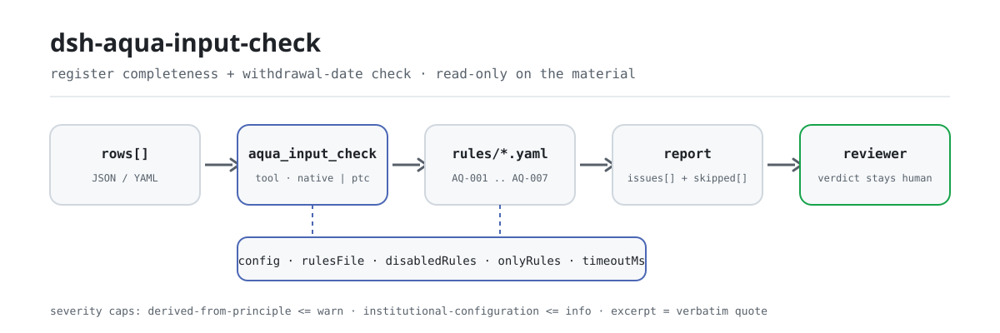

<div align="center">

<picture>
  <source media="(prefers-color-scheme: dark)" srcset="docs/assets/dsh-aqua-input-check-flow-dark.svg">
  
</picture>

# dsh-aqua-input-check

**Check an aquaculture input register for completeness and withdrawal-period date arithmetic — you get a list of which row, which column, and what to fix; the verdict stays with the reviewer.**

A data-only checker plugin for DeepSeek Harness: it reads one input register (the farm header plus one row per record), applies the versioned rule pack it ships (AQ-001..AQ-007), and lists only the differences it can point to inside the material — never a compliance verdict, never a liability finding.

[Install](#three-step-setup) · [Configuration](#configuration) · [FAQ](#faq) · [简体中文](README.md) · [English](README.en.md) · [Español](README.es.md) · [Português](README.pt.md) · [हिन्दी](README.hi.md)

[](LICENSE)
[](#compatibility)
[](https://www.npmjs.com/package/dsh-aqua-input-check)
[](https://github.com/PerryLink/dsh-aqua-input-check/actions/workflows/ci.yml)
[](#compatibility)

[](https://github.com/PerryLink/dsh-aqua-input-check/stargazers)
[](https://www.npmjs.com/package/dsh-aqua-input-check)
[](https://dshfind.com/plugins/PerryLink/dsh-aqua-input-check?ref=badge)
[](https://securityscorecards.dev/viewer/?uri=github.com/PerryLink/dsh-aqua-input-check)
[](https://dsh.market/)
[](https://gitee.com/perrylink/dsh-aqua-input-check)

```sh
dsh plugin --profile <name> add dsh-aqua-input-check
```

</div>

<sub>Community plugin, not affiliated with DeepSeek. Canonical repository: <https://github.com/PerryLink/dsh-aqua-input-check> (Gitee is a mirror).</sub>

## What it is

`dsh-aqua-input-check` reads one aquaculture input register — the farm header plus one row per input record — and checks that register's own completeness and date arithmetic: that each record names its pond and species, that a named input records its quantity and use date, that the use date is not in the future, that harvesting respects the withdrawal period the record itself states, that a stocking record carries its source and quarantine certificate number, that the input type comes from your configured vocabulary, and that batch numbers are unique.

It does not decide whether farming practice is compliant, whether the product is safe to eat, whether medication was appropriate, or whether a penalty applies.

- **Who it is for**: aquaculture record keepers; no command line required — hand the material over in chat.
- **What you give it**: the source material the check works on (a table, register, or document); the original is never modified. Excel can be converted to JSON/YAML first, in chat if the platform supports it.
- **What you get back**: a list of "which row, which column, what is missing, how to fix it"; every check that could not run is listed in `skipped` with its reason.

## Three-step setup

1. **Install** (pick one channel):

   ```sh
   # git channel (latest main; equivalent to git+https://github.com/PerryLink/dsh-aqua-input-check.git)
   dsh plugin --profile <name> add github:PerryLink/dsh-aqua-input-check
   # npm channel (published releases)
   dsh plugin --profile <name> add dsh-aqua-input-check
   # tarball channel: pnpm pack in this repo, then
   dsh plugin --profile <name> add ./dsh-aqua-input-check-<version>.tgz
   ```

2. **Minimal config** (sane defaults; a bundle row without `config` uses every default, with the rule-pack path pointing at the bundled `rules/aqua-input-check.yaml`):

   ```yaml
   - insert:
       - id: dsh-aqua-input-check
         name: dsh-aqua-input-check
   ```

3. **Verify it mounts**:

   ```sh
   dsh --profile <name> --dump-config | grep 'dsh-aqua-input-check'
   ```

   Then hand it a register — for example the bundled sample (expected output in `samples/quickstart/expected/result.json`):

   ```text
   > Run this check on the bundled sample and tell me how many issues it found and their severities.
   aqua_input_check: 1 issue(s) — warn 1 (AQ-001: pond number and species both empty); skipped: 2
   ```

**Uninstall**: `dsh plugin --profile <name> remove dsh-aqua-input-check` (or remove the row from the profile patch).

<details>
<summary>Use it in WorkBuddy / Coze</summary>

Search "Professional Document Check Suite" in WorkBuddy / Coze (the full set; this check is one part of it; availability as listed) to call the same checking capability without a command line.

</details>

<details>
<summary>Install from the DSH Desktop market</summary>

Every PerryLink plugin is listed in the built-in DSH Desktop market: **Market → Sources → Add source → paste** `https://perrylink-dsh-catalog.perrylink.workers.dev/catalog-source.json` **→ select**. Installation still requires the market's npm identity check and your confirmation.

</details>

## Core capabilities

`dsh-aqua-input-check` registers the `aqua_input_check` tool: it reads one input register, applies a versioned rule pack, and returns a report.

- **Seven rules in one data pack** — the rule pack is data, not code (`rules/aqua-input-check.yaml`); replacing it switches the whole rule set without touching a line of TypeScript.
- **Read-only on the material** — accepts JSON or YAML and never modifies the original; pure ESM, no network requests, no model calls.
- **No fabricated citations** — every rule carries `document` / `number` / `clause` / `excerpt` / `kind` / `source`; `excerpt` must be a verbatim quotation, and rules whose clause text could not be obtained this pass say so in the `excerpt` itself and stay marked `derived-from-principle`.
- **Severity follows the evidence** — `derived-from-principle` is capped at `warn`, institutional configuration (`institutional-configuration`) at `info`, and a test asserts it.
- **An empty issue list is never "nothing is wrong"** — every check that could not run is reported in `skipped` with its reason; a rule whose required list is unset reports itself in `skipped` rather than passing silently.
- **No adjudicating wording** — the report lists differences and never pronounces on compliance, liability, or correctness; a wording guard enforces this and every report carries the disclaimer.

| Rule | Check | Severity | Basis kind |
|---|---|---|---|
| `AQ-001` | the pond and species are recorded | warn | principle |
| `AQ-002` | a named input records its quantity and date | warn | principle |
| `AQ-003` | the use date is not in the future | warn | principle |
| `AQ-004` | harvest respects the recorded withdrawal period | warn | principle |
| `AQ-005` | stocking records its source and quarantine number | warn | principle |
| `AQ-006` | the input type comes from your vocabulary (off by default) | info | local |
| `AQ-007` | batch numbers are unique | warn | principle |

### Examples

These are the plugin's real entry points; install once, then call one. The first row of the table below is the detailed walkthrough, the remaining rows are short cases.

**Detailed example** — tool `aqua_input_check`, input:

```json
{"rows":[{"序号":"1","塘口编号":"","养殖品种":"","投苗日期":"2026-02-20", ...}]}
```

Output:

```json
{
  "id": "dsh-aqua-input-check.AQ-001.de09b5a6",
  "ruleId": "AQ-001",
  "severity": "warn",
  "locator": {
    "row": 1,
    "field": "pondNo"
  },
  "found": "第 1 行 pondNo、species 都为空",
  "expected": "pondNo、species 至少应填写一项",
  "fix": "补填塘口编号与养殖品种；本条只核对是否填写"
}
```

*Observed from `dsh-aqua-input-check/tests/fixtures/AQ-001/AQ-001-unsafe.json; dsh-aqua-input-check/tests/fixtures/AQ-001/cases.json; dsh-aqua-input-check/rules/aqua-input-check.yaml; dsh-aqua-input-check/tests/index.test.ts`*

| You ask | What it answers |
|---|---|
| A record names the input but leaves the pond and the species column empty. | `AQ-001` requires at least one of `pondNo` and `species` on every record. It only checks that one of the two is filled in, and does not judge whether that input is suitable for that species. |
| The input name is there, but the quantity and the use date are blank. | `AQ-002` asks for `inputQty` and `usedAt` whenever `inputName` is filled in. It checks that the fields are recorded, not that the dosage is appropriate or that the medication suits the disease. |
| The use date is written as `15/03/2026`, and one row carries next month's date. | `AQ-003` accepts `2026-03-15` and `2026-03-15 09:30`; a `usedAt` it cannot parse is reported as unparseable, and one later than the check date is reported as a future date. It does not touch the withdrawal period — the pack ships no withdrawal days at all. |
| We treated on 1 June with 20 withdrawal days recorded and harvested on 15 June. Is that caught? | Yes. `AQ-004` compares `usedAt`, `harvestAt` and the record's own `withdrawalDays`, and reports the row as short by the difference. A finding means "by the withdrawal period you recorded, harvest came early" — not that the product is unsafe, which needs a residue test this plugin cannot see. If those three fields are not all filled and parseable, the rule reports `skipped` instead of assuming a period. |
| The input type we use is not in the list — nothing is reported. | `AQ-006` reports `skipped` because the pack ships no input-type vocabulary: `values` is empty until you configure one. Once set, the rule checks that the stored `inputType` is one of your values. It does not judge whether that input may lawfully be used — that needs the prohibited-drug list and the product's approval number. |
| The same batch number appears in two rows. | `AQ-007` reports the repeat and names both rows. It compares with whitespace ignored; several input entries for one batch are normal as long as they share the batch number — do not reuse the row-number column for it. With no batch-number column it reports that it could not run instead of passing silently. |

## Standards it follows

| Document | Number | Cited by rules |
|---|---|---|
| Quality and Safety Management Regulation for Aquaculture (Ministry of Agriculture decree; the canonical Chinese title is recorded in `rules/evidence/`) | Ministry of Agriculture decree (current decree and clause numbers not verified this pass) | AQ-001, AQ-002, AQ-005, AQ-007 |
| Green Food — Guidelines for the Use of Fishery Drugs | NY/T 755—2022 (issued 2022-07-11, effective 2022-10-01; fully replaces the repealed NY/T 755—2013; part of the Green Food standard series; clause numbers not obtained this pass) | AQ-003, AQ-004 |
| Institutional aquaculture production management vocabulary (configured by your institution) | No unified standard (the basis is the institution's configured type vocabulary) | AQ-006 |

**Boundary:** this plugin checks an **aquaculture input register** for completeness and date arithmetic — that each record names its pond and species, that a named input records its quantity and use date, that the use date is not in the future, that harvesting respects the withdrawal period the record states, that stocking records its source and quarantine certificate, that the input type comes from your vocabulary, and that batch numbers are unique. It does **not** decide whether farming practice is compliant, whether the product is safe to eat, whether medication was appropriate, or whether a penalty applies.

> ### ⚠️ Read this before trusting a citation in the report
>
> **`excerpt` status is per rule, not uniform.** Some rules quote the clause verbatim (`kind: direct`), some are derived from the principle of the cited articles (`kind: derived-from-principle`, capped at `warn`), and some use thresholds your institution configures (`kind: institutional-configuration`, capped at `info`). The pack never paraphrases a quotation: when the text was not obtained, the `excerpt` field says so and the reasoning lives in `note`; a test asserts that no rule claims a quotation it does not have. **For any rule still marked as not obtained, replace the `excerpt` with the real clause and raise `kind` to `direct` once the text is in hand.**
>
> The conclusion is the reviewer's: this plugin lists differences it can point to in the material and does not decide facts or compliance.

## Configuration

All tunables are Schemastery `Config` fields in `src/config.ts` (changeable from cordis.yml); the per-rule thresholds live in the rule pack under `rules/`. An id-targeted override replaces the whole row — restate every key you need.

| Key | Type | Default | Description |
|---|---|---|---|
| `rulesFile` | string | `rules/aqua-input-check.yaml` | Rule-pack path, relative to the package root |
| `disabledRules` | string[] | `[]` | Rule ids to stop running; each appears in `skipped` |
| `onlyRules` | string[] | `[]` | Run only these rule ids; empty runs every rule |
| `skipNotes` | string | `""` | Note appended to every `skipped` reason |
| `timeoutMs` | number | `120000` | Cooperative tool timeout budget |

Rule-level parameters worth knowing:

- `AQ-004` `earlierField` / `laterField` / `minDaysField` — the two dates and the column holding the required gap. The period comes from the record, so no figure is built in.
- `AQ-006` `values` — your input types, e.g. `[compound feed, chilled fish, water-quality improver, antibacterial, antiparasitic, disinfectant, vaccine]`. Empty means no check.
- `AQ-002` `conditionField` / `requiredFields` — what triggers the quantity-and-date requirement.

Example override in your profile patch:

```yaml
- insert:
    - id: dsh-aqua-input-check
      name: dsh-aqua-input-check
      config:
        disabledRules: [AQ-007]
        timeoutMs: 180000
```

## Material format

The tool accepts JSON or YAML:

```yaml
farm: 某某水产养殖场
site: 某某镇某某村
area: 86 亩
rows:
  - { 序号: '1', 批次编号: B-2026-0001, 塘口编号: T-03, 养殖品种: 草鱼,
      投苗日期: 2026-02-20, 苗种来源: 某某苗种场, 检疫证号: JY-2026-0031,
      投入品类型: 配合饲料, 投入品名称: 草鱼配合饲料 2 号, 投入量: '350',
      投入量单位: kg, 使用日期: 2026-03-01, 休药期天数: '0', 起捕日期: 2026-06-20 }
```

Column names are matched case-insensitively and ignoring spaces, underscores and hyphens; the register's own column names are kept, so a finding names the column it read. Note that the row-sequence column is read as the row's display number — give the batch identifier its own column. Fields are optional at the reader layer and validated by the check engine, so a partially exported register produces "missing item" findings instead of a crash.

## Rule sources

Rule data lives in `rules/aqua-input-check.yaml`, separated from the code: every rule carries document, number, clause in the source's own numbering, a verbatim excerpt, and a source URL. The pack's header states the citation gap in full, and each rule's `note` repeats the part that matters for that rule. The load-time guard that normally enforces "an excerpt must be a real quotation of at least eight characters" cannot tell a quotation from a description — so this pack leans on the header, the per-rule notes, and a test that asserts every `excerpt` admits the gap. A pack that overstates its basis fails at load time instead of producing a confident-looking report. The boundaries confirmed during verification and the conclusions deliberately **not** drawn ship in the bundled `rules/evidence/` directory.

## FAQ

<details>
<summary>Does it decide compliance for us?</summary>

No. It lists only the differences it can point to inside the material (which row, which column, what is missing, how to fix it) and decides neither facts nor compliance — the conclusion always stays with the reviewer. A wording guard enforces the report's wording, and every report carries the disclaimer.

</details>

<details>
<summary>My register is an Excel file. Can I use it directly?</summary>

Yes — convert it to JSON or YAML first; in chat the platform can do the conversion for you if supported. The tool only reads the material and never modifies the original.

</details>

<details>
<summary>Why does `AQ-006` never report anything?</summary>

Because the pack ships no input-type vocabulary: `values` is empty out of the box, so the rule reports itself in `skipped`. Fill `values` with the input types your farm uses and the rule starts checking that the recorded type is one of them — it still does not judge whether an input may lawfully be used.

</details>

<details>
<summary>Can an empty `issues` list be read as "nothing is wrong"?</summary>

No. Every check that could not run is listed in `skipped` with its reason (a missing date, a missing withdrawal period, an unset vocabulary). Read `issues` and `skipped` together before drawing any conclusion from a report.

</details>

<details>
<summary>Will it cope with a whole season of records at once?</summary>

The tool works in both `native` and `ptc` modes; for batch work (a season of records or a whole directory) use `ptc`, where the schema cost is paid once. The checks themselves are local column matching and date arithmetic — no network requests, no model calls; `timeoutMs` (default 120 s) is the cooperative timeout budget.

</details>

## Troubleshooting

- **`AQ-004` reports itself as skipped.** One of the two dates or the withdrawal period is missing. Records of feeding with no harvest, for instance, are simply out of scope.
- **`AQ-004` fires but I believe the batch is safe.** The finding is arithmetic: harvest came earlier than the period **you recorded**. Whether residue is a problem needs a test result.
- **`AQ-006` never runs.** Its vocabulary is empty; fill it with the input types your farm uses.
- **`AQ-007` fires on a batch with several input records.** Several records for one batch should share the batch number. If your register instead numbers each line, disable the rule or use a distinct identifier column.
- **The plugin installs but the tool never appears.** Check that `main` resolves to `lib/index.mjs` and that `pnpm run build` produced it; a wrong `main` makes the loader skip the entry silently.
- **`dsh plugin add` refuses the package as incompatible.** The peer range covers `0.1.x` and `0.2.x`; if your runtime sits outside it, grant an explicit exemption: `dsh plugin --profile <name> allow-version dsh-aqua-input-check@0.1.0 --dsh-version <runtime> --accept-risk`
- **`check` reports `manifest-peers` as failed.** The static checker compares against a hard-coded peer range that predates the 0.2 line. The runtime enforces peer compatibility at install time, so the declared range is the correct one; this is a known upstream issue in `dsh-plugin-dev`.
- **Times look shifted.** All arithmetic is wall-clock on the input strings, with no timezone conversion.

## Compatibility

| Surface | Status |
|---|---|
| Harness | Peer range `>=0.1.2-rc.1 <0.2.0 \|\| >=0.2.0-0 <0.3.0` — verified to accept both `0.2.0-rc.2` and `0.2.1-rc.2`. `engines.dsh` is declared as `>=0.2.1-0 <0.3.0` and is enforced by the host since 0.2.1 |
| Node | `^22.19.0 \|\| >=24.0.0` |
| Platforms | All (plain ESM; no native code, no network, no model call) |
| Tool mode | Works in `native` and `ptc`; for a season of records use `ptc` |

## Ecosystem & quality

- [Gitee mirror](https://gitee.com/perrylink/dsh-aqua-input-check) (sync mirror; GitHub is canonical)
- [dshfind plugin page](https://dshfind.com/plugins/PerryLink/dsh-aqua-input-check) (installs and ranking)
- [OpenSSF Scorecard report](https://securityscorecards.dev/viewer/?uri=github.com/PerryLink/dsh-aqua-input-check) (driven by [.github/workflows/scorecard.yml](.github/workflows/scorecard.yml))
- [DSH Market](https://dsh.market/) (listed)
- **1024 store channel**: `npm i -g dsh1024` once, then `dsh1024 plugin --profile <name> add dsh-aqua-input-check` (counts toward the [deepseek1024.com](https://deepseek1024.com) install ranking)
- [Ecosystem knowledge base](https://perrylink.github.io/dsh-plugin-guide/) — plugin development guide · measured selection data · maintenance criteria

## Development

```sh
pnpm install                                        # node ^22.19 || >=24
pnpm run typecheck                                  # tsc --noEmit
pnpm test                                           # vitest: shared table-plugin suite + paired fixtures
pnpm run build                                      # tsdown -> lib/index.mjs + lib/index.d.mts
pnpm run verify:self-contained                      # dependency specs resolve from the registry
pnpm run check:lockfile                             # lockfile drift check
pnpm run check:readmes                              # five-language README consistency
pnpm run check:citations                            # rule-pack citation baseline
node ../scripts/sync-shared.mjs dsh-aqua-input-check   # refresh src/shared from ../_shared
pnpm pack                                           # the published tarball
```

The plugin is **data-only**: `src/model.ts` declares the table shape, the shared kit supplies the reader and the check engine, and the rule pack declares every check. Local sample run (needs `pnpm run build` first to produce `lib/`):

```sh
node samples/quickstart/run.mjs --json
# => {"tool":"aqua_input_check","issueCount":1,"summary":{"error":0,"warn":1,"info":0},"skippedCount":2}
```

The sample input lives in `samples/quickstart/input/`, the expected output in `samples/quickstart/expected/result.json`, and a screenshot in `docs/assets/quickstart.png`. The README images are generated programmatically by [`scripts/gen-readme-assets.py`](scripts/gen-readme-assets.py) (Python + Pillow) and are safe to re-run; the older single-skin flow diagram and demo images stay in `docs/assets/` for external deep links, while the READMEs reference only the new light/dark pair.

Topics: `deepseek-harness`, `dsh`, `dsh-plugin`, `cordis`, `aqua`, `input`

## Family & thanks

This project is part of the DeepSeek Harness plugin family from [PerryLink](https://github.com/PerryLink) (all Apache-2.0). Full family index: [choose a checker by material](https://perrylink.github.io/zh/checkers/choose/) and [all plugins](https://github.com/PerryLink). If it is useful, **a star helps the next person find it** — nothing is gated behind it.

- [@PerryLink](https://github.com/PerryLink) — creator and maintainer: the data-only rule pack (AQ-001..AQ-007), the `aqua_input_check` tool, the citation-verification record, and the five-language docs.

<details>
<summary>Expand all plugins</summary>

| Plugin | Status |
|---|---|
| **[dsh-aqua-input-check](https://github.com/PerryLink/dsh-aqua-input-check)** |  |
| **[dsh-archive-check](https://github.com/PerryLink/dsh-archive-check)** |  |
| **[dsh-auto-review](https://github.com/PerryLink/dsh-auto-review)** |  |
| **[dsh-autotier](https://github.com/PerryLink/dsh-autotier)** | 🧊 FROZEN — see the repo README |
| **[dsh-bid-ca-precheck](https://github.com/PerryLink/dsh-bid-ca-precheck)** |  |
| **[dsh-bid-qual-check](https://github.com/PerryLink/dsh-bid-qual-check)** |  |
| **[dsh-cert-mcp](https://github.com/PerryLink/dsh-cert-mcp)** | 🧊 FROZEN — see the repo README |
| **[dsh-checkpoint-rewind](https://github.com/PerryLink/dsh-checkpoint-rewind)** |  |
| **[dsh-click](https://github.com/PerryLink/dsh-click)** |  |
| **[dsh-composer-history](https://github.com/PerryLink/dsh-composer-history)** |  |
| **[dsh-contract-stance](https://github.com/PerryLink/dsh-contract-stance)** |  |
| **[dsh-customs-doc-check](https://github.com/PerryLink/dsh-customs-doc-check)** |  |
| **[dsh-data-quality](https://github.com/PerryLink/dsh-data-quality)** | 🧊 FROZEN — see the repo README |
| **[dsh-demurrage-ledger](https://github.com/PerryLink/dsh-demurrage-ledger)** |  |
| **[dsh-doublecheck](https://github.com/PerryLink/dsh-doublecheck)** |  |
| **[dsh-drill-script-check](https://github.com/PerryLink/dsh-drill-script-check)** |  |
| **[dsh-eia-guide-check](https://github.com/PerryLink/dsh-eia-guide-check)** |  |
| **[dsh-emergency-plan](https://github.com/PerryLink/dsh-emergency-plan)** |  |
| **[dsh-essay-rubric-check](https://github.com/PerryLink/dsh-essay-rubric-check)** |  |
| **[dsh-evidence-check](https://github.com/PerryLink/dsh-evidence-check)** |  |
| **[dsh-export-ctl-check](https://github.com/PerryLink/dsh-export-ctl-check)** |  |
| **[dsh-fast](https://github.com/PerryLink/dsh-fast)** |  |
| **[dsh-fmea-table-check](https://github.com/PerryLink/dsh-fmea-table-check)** |  |
| **[dsh-forecast-penalty](https://github.com/PerryLink/dsh-forecast-penalty)** |  |
| **[dsh-fund-research](https://github.com/PerryLink/dsh-fund-research)** |  |
| **[dsh-github](https://github.com/PerryLink/dsh-github)** |  |
| **[dsh-gongwen-flow-check](https://github.com/PerryLink/dsh-gongwen-flow-check)** |  |
| **[dsh-gongwen-word-check](https://github.com/PerryLink/dsh-gongwen-word-check)** |  |
| **[dsh-guard-plan-qc](https://github.com/PerryLink/dsh-guard-plan-qc)** |  |
| **[dsh-hazchem-check](https://github.com/PerryLink/dsh-hazchem-check)** |  |
| **[dsh-hazplan-check](https://github.com/PerryLink/dsh-hazplan-check)** |  |
| **[dsh-hidden-risk-map](https://github.com/PerryLink/dsh-hidden-risk-map)** |  |
| **[dsh-hs-classify](https://github.com/PerryLink/dsh-hs-classify)** |  |
| **[dsh-icd-rule-check](https://github.com/PerryLink/dsh-icd-rule-check)** |  |
| **[dsh-industry-research](https://github.com/PerryLink/dsh-industry-research)** |  |
| **[dsh-lawcite-adapter](https://github.com/PerryLink/dsh-lawcite-adapter)** |  |
| **[dsh-laya](https://github.com/PerryLink/dsh-laya)** |  |
| **[dsh-lc-doc-check](https://github.com/PerryLink/dsh-lc-doc-check)** |  |
| **[dsh-learning-gap-check](https://github.com/PerryLink/dsh-learning-gap-check)** |  |
| **[dsh-library](https://github.com/PerryLink/dsh-library)** |  |
| **[dsh-local-ai](https://github.com/PerryLink/dsh-local-ai)** |  |
| **[dsh-lsp-actions](https://github.com/PerryLink/dsh-lsp-actions)** |  |
| **[dsh-mask](https://github.com/PerryLink/dsh-mask)** |  |
| **[dsh-mcp-panel](https://github.com/PerryLink/dsh-mcp-panel)** |  |
| **[dsh-medrec-qc](https://github.com/PerryLink/dsh-medrec-qc)** |  |
| **[dsh-memento](https://github.com/PerryLink/dsh-memento)** | 🧊 FROZEN — see the repo README |
| **[dsh-nsfc-form-check](https://github.com/PerryLink/dsh-nsfc-form-check)** |  |
| **[dsh-nurse-record-check](https://github.com/PerryLink/dsh-nurse-record-check)** |  |
| **[dsh-observe](https://github.com/PerryLink/dsh-observe)** |  |
| **[dsh-origin-rvc-check](https://github.com/PerryLink/dsh-origin-rvc-check)** |  |
| **[dsh-ota-review-check](https://github.com/PerryLink/dsh-ota-review-check)** |  |
| **[dsh-output-styles](https://github.com/PerryLink/dsh-output-styles)** |  |
| **[dsh-paper-doc-adapter](https://github.com/PerryLink/dsh-paper-doc-adapter)** |  |
| **[dsh-permission-rules](https://github.com/PerryLink/dsh-permission-rules)** |  |
| **[dsh-permit-report-check](https://github.com/PerryLink/dsh-permit-report-check)** |  |
| **[dsh-pipeline-check](https://github.com/PerryLink/dsh-pipeline-check)** |  |
| **[dsh-pleading-draft](https://github.com/PerryLink/dsh-pleading-draft)** |  |
| **[dsh-plugin-doctor](https://github.com/PerryLink/dsh-plugin-doctor)** | 🚫 RETIRED (repo archived) |
| **[dsh-plugin-guide](https://github.com/PerryLink/dsh-plugin-guide)** |  |
| **[dsh-plugin-kit](https://github.com/PerryLink/dsh-plugin-kit)** | 🚫 RETIRED (repo archived) |
| **[dsh-plugin-upgrade](https://github.com/PerryLink/dsh-plugin-upgrade)** | 🚫 RETIRED (repo archived) |
| **[dsh-policy-brief-draft](https://github.com/PerryLink/dsh-policy-brief-draft)** |  |
| **[dsh-power-loss-split](https://github.com/PerryLink/dsh-power-loss-split)** |  |
| **[dsh-power-ticket-check](https://github.com/PerryLink/dsh-power-ticket-check)** |  |
| **[dsh-ppap-check](https://github.com/PerryLink/dsh-ppap-check)** |  |
| **[dsh-protest-deadline](https://github.com/PerryLink/dsh-protest-deadline)** |  |
| **[dsh-railway-window](https://github.com/PerryLink/dsh-railway-window)** |  |
| **[dsh-repair-order-qc](https://github.com/PerryLink/dsh-repair-order-qc)** |  |
| **[dsh-research-report](https://github.com/PerryLink/dsh-research-report)** |  |
| **[dsh-review-reply-check](https://github.com/PerryLink/dsh-review-reply-check)** |  |
| **[dsh-rulefile-check](https://github.com/PerryLink/dsh-rulefile-check)** |  |
| **[dsh-safety-brief-check](https://github.com/PerryLink/dsh-safety-brief-check)** |  |
| **[dsh-score](https://github.com/PerryLink/dsh-score)** | 🧊 FROZEN — see the repo README |
| **[dsh-session-sync](https://github.com/PerryLink/dsh-session-sync)** |  |
| **[dsh-site-log-check](https://github.com/PerryLink/dsh-site-log-check)** |  |
| **[dsh-skill-pack-security](https://github.com/PerryLink/dsh-skill-pack-security)** |  |
| **[dsh-soe-decision-check](https://github.com/PerryLink/dsh-soe-decision-check)** |  |
| **[dsh-soilwater-check](https://github.com/PerryLink/dsh-soilwater-check)** |  |
| **[dsh-sop-sync-check](https://github.com/PerryLink/dsh-sop-sync-check)** |  |
| **[dsh-spc-gbt-adapter](https://github.com/PerryLink/dsh-spc-gbt-adapter)** |  |
| **[dsh-talk](https://github.com/PerryLink/dsh-talk)** |  |
| **[dsh-tender-extract](https://github.com/PerryLink/dsh-tender-extract)** |  |
| **[dsh-tender-matrix](https://github.com/PerryLink/dsh-tender-matrix)** |  |
| **[dsh-test-drive](https://github.com/PerryLink/dsh-test-drive)** |  |
| **[dsh-ticktick](https://github.com/PerryLink/dsh-ticktick)** | 🚫 RETIRED (repo archived) |
| **[dsh-translate](https://github.com/PerryLink/dsh-translate)** |  |
| **[dsh-warranty-calc](https://github.com/PerryLink/dsh-warranty-calc)** |  |
| **[dsh-budget](https://github.com/PerryLink/dsh-budget)** | 🧊 FROZEN — see the repo README |
| **[dsh-claude-move](https://github.com/PerryLink/dsh-claude-move)** | 🧊 FROZEN — see the repo README |
| **[dsh-defend](https://github.com/PerryLink/dsh-defend)** | 🧊 FROZEN — see the repo README |
| **[dsh-draw](https://github.com/PerryLink/dsh-draw)** | 🧊 FROZEN — see the repo README |
| **[dsh-reach](https://github.com/PerryLink/dsh-reach)** | 🧊 FROZEN — see the repo README |
| **[dsh-background-agents](https://github.com/PerryLink/dsh-background-agents)** | 🚫 RETIRED (repo archived) |
| **[dsh-session-pin](https://github.com/PerryLink/dsh-session-pin)** | 🚫 RETIRED (repo archived) |
| **[dsh-team-rooms](https://github.com/PerryLink/dsh-team-rooms)** | 🚫 RETIRED (repo archived) |

</details>

## License

[LICENSE](LICENSE) (Apache License 2.0) © 2026 dsh-aqua-input-check contributors

<p align="center"><sub>Apache-2.0 · Community plugin, not affiliated with DeepSeek.</sub></p>
