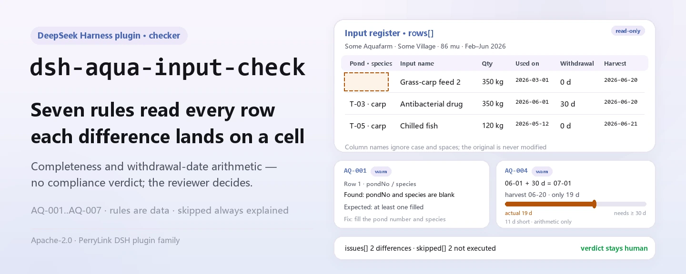
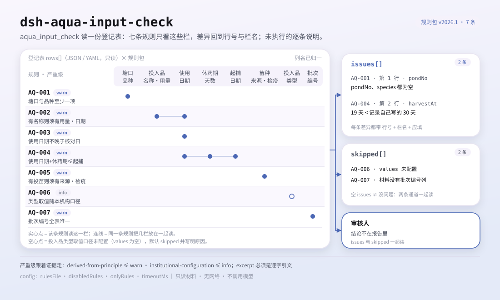

<div align="center">

<picture>
  <source media="(prefers-color-scheme: dark)" srcset="docs/assets/dsh-aqua-input-check-hero-en-dark.webp">
  
</picture>

# dsh-aqua-input-check

**Comprueba la completitud de un registro de insumos de acuicultura y la aritmética de fechas del periodo de retiro: obtienes una lista de qué fila, qué columna y qué falta; el veredicto queda en manos del revisor.**

Un plugin verificador de solo datos para DeepSeek Harness: lee un registro de insumos (la cabecera de la granja más una fila por registro), aplica el paquete de reglas versionado que incluye (AQ-001..AQ-007) y solo enumera las diferencias que puede señalar dentro del material — nunca un veredicto de cumplimiento, nunca una atribución de responsabilidad.

[Instalar](#instalación-en-tres-pasos) · [Configuración](#configuración) · [FAQ](#faq) · [简体中文](README.md) · [English](README.en.md) · [Español](README.es.md) · [Português](README.pt.md) · [हिन्दी](README.hi.md)

[](LICENSE)
[](#compatibilidad)
[](https://www.npmjs.com/package/dsh-aqua-input-check)
[](https://github.com/PerryLink/dsh-aqua-input-check/actions/workflows/ci.yml)
[](#compatibilidad)

[](https://github.com/PerryLink/dsh-aqua-input-check/stargazers)
[](https://www.npmjs.com/package/dsh-aqua-input-check)
[](https://dshfind.com/plugins/PerryLink/dsh-aqua-input-check?ref=badge)
[](https://securityscorecards.dev/viewer/?uri=github.com/PerryLink/dsh-aqua-input-check)
[](https://dsh.market/)
[](https://gitee.com/perrylink/dsh-aqua-input-check)

```sh
dsh plugin --profile <name> add dsh-aqua-input-check
```

</div>

<sub>Plugin de la comunidad, no afiliado a DeepSeek. Repositorio canónico: <https://github.com/PerryLink/dsh-aqua-input-check> (Gitee es un espejo).</sub>

## Qué es

`dsh-aqua-input-check` lee un registro de insumos de acuicultura —la cabecera de la granja más una fila por registro de insumo— y comprueba la completitud y la aritmética de fechas de ese registro: que cada registro indique su estanque y su especie, que un insumo con nombre registre su cantidad y su fecha de uso, que la fecha de uso no sea futura, que la cosecha respete el periodo de retiro que el propio registro declara, que el registro de siembra anote su origen y su número de certificado de cuarentena, que el tipo de insumo provenga del vocabulario que usted configure y que los números de lote sean únicos.

No decide si la práctica de cultivo cumple la normativa, ni si el producto es apto para el consumo, ni si la medicación fue adecuada, ni si procede una sanción.

- **Para quién es**: encargados de los registros de una granja acuícola; no hace falta línea de comandos, basta entregar el material en el chat.
- **Qué entrega usted**: el material fuente sobre el que trabaja la comprobación (una tabla, un registro o un documento); el original nunca se modifica. Excel puede convertirse antes a JSON/YAML, en el propio chat si la plataforma lo permite.
- **Qué recibe**: una lista de «qué fila, qué columna, qué falta, cómo corregirlo»; cada comprobación que no pudo ejecutarse aparece en `skipped` con su motivo.

<picture>
  <source media="(prefers-color-scheme: dark)" srcset="docs/assets/dsh-aqua-input-check-flow-v5-dark.svg">
  
</picture>

## Instalación en tres pasos

1. **Instale** (elija un canal):

   ```sh
   # canal git (main más reciente; equivalente a git+https://github.com/PerryLink/dsh-aqua-input-check.git)
   dsh plugin --profile <name> add github:PerryLink/dsh-aqua-input-check
   # canal npm (versiones publicadas)
   dsh plugin --profile <name> add dsh-aqua-input-check
   # canal tarball: pnpm pack en este repo y después
   dsh plugin --profile <name> add ./dsh-aqua-input-check-<version>.tgz
   ```

2. **Configuración mínima** (valores por defecto listos para usar; una fila bundle sin `config` aplica todos los valores por defecto y la ruta del paquete de reglas apunta al `rules/aqua-input-check.yaml` incluido):

   ```yaml
   - insert:
       - id: dsh-aqua-input-check
         name: dsh-aqua-input-check
   ```

3. **Verifique que se monta**:

   ```sh
   dsh --profile <name> --dump-config | grep 'dsh-aqua-input-check'
   ```

   Después entréguele un registro —por ejemplo la muestra incluida en el repositorio (salida esperada en `samples/quickstart/expected/result.json`):

   ```text
   > Ejecuta esta comprobación con la muestra incluida y dime cuántos hallazgos hay y de qué nivel.
   aqua_input_check: 1 issue(s) — warn 1 (AQ-001: estanque y especie vacíos); skipped: 2
   ```

**Desinstalar**: `dsh plugin --profile <name> remove dsh-aqua-input-check` (o elimine la fila del patch del perfil).

<details>
<summary>Usarlo en WorkBuddy / Coze</summary>

Busque «Professional Document Check Suite» en WorkBuddy / Coze (el conjunto completo; esta comprobación es una parte; disponibilidad según la tienda) para invocar la misma capacidad de verificación sin línea de comandos.

</details>

<details>
<summary>Instalar desde el mercado de DSH Desktop</summary>

Todos los plugins de PerryLink se pueden explorar en el mercado integrado de DSH Desktop: **Mercado → Fuentes → Añadir fuente → pegue** `https://perrylink-dsh-catalog.perrylink.workers.dev/catalog-source.json` **→ seleccione**. La instalación sigue requiriendo la verificación de identidad npm del mercado y su confirmación.

</details>

## Capacidades clave

`dsh-aqua-input-check` registra la herramienta `aqua_input_check`: lee un registro de insumos, aplica un paquete de reglas versionado y devuelve un informe.

- **Siete reglas en un paquete de datos** — el paquete de reglas es datos, no código (`rules/aqua-input-check.yaml`); sustituirlo cambia todo el conjunto de reglas sin tocar una línea de TypeScript.
- **Solo lectura sobre el material** — acepta JSON o YAML y nunca modifica el original; ESM puro, sin peticiones de red y sin llamadas al modelo.
- **Sin citas inventadas** — cada regla lleva `document` / `number` / `clause` / `excerpt` / `kind` / `source`; `excerpt` debe ser una cita literal, y las reglas cuyo texto de cláusula no se pudo obtener esta vez lo dicen en el propio `excerpt` y permanecen marcadas como `derived-from-principle`.
- **La severidad sigue a la evidencia** — `derived-from-principle` tiene como tope `warn`, la configuración institucional (`institutional-configuration`) tiene como tope `info`, y un test lo garantiza.
- **Una lista vacía nunca es «todo está bien»** — cada comprobación que no pudo ejecutarse se informa en `skipped` con su motivo; una regla cuya lista obligatoria no está configurada se autoinforma en `skipped` en lugar de pasar en silencio.
- **Sin redacción adjudicadora** — el informe enumera diferencias y nunca se pronuncia sobre cumplimiento, responsabilidad o corrección; un guardián de redacción (wording guard) lo impone y cada informe lleva el descargo.

| Regla | Comprobación | Severidad | Tipo de base |
|---|---|---|---|
| `AQ-001` | el estanque y la especie están registrados | warn | principle |
| `AQ-002` | un insumo con nombre registra su cantidad y su fecha | warn | principle |
| `AQ-003` | la fecha de uso no es futura | warn | principle |
| `AQ-004` | la cosecha respeta el periodo de retiro registrado | warn | principle |
| `AQ-005` | la siembra registra su origen y su número de cuarentena | warn | principle |
| `AQ-006` | el tipo de insumo proviene de su vocabulario (desactivada por defecto) | info | local |
| `AQ-007` | los números de lote son únicos | warn | principle |

### Ejemplos

Estos son los puntos de entrada reales del plugin; instálelo una vez e invoque uno. La primera fila de la tabla siguiente es el recorrido detallado y las demás son casos breves.

**Ejemplo detallado** — herramienta `aqua_input_check`, entrada:

```json
{"rows":[{"序号":"1","塘口编号":"","养殖品种":"","投苗日期":"2026-02-20", ...}]}
```

Salida:

```json
{
  "id": "dsh-aqua-input-check.AQ-001.de09b5a6",
  "ruleId": "AQ-001",
  "severity": "warn",
  "locator": {
    "row": 1,
    "field": "pondNo"
  },
  "found": "第 1 行 pondNo、species 都为空",
  "expected": "pondNo、species 至少应填写一项",
  "fix": "补填塘口编号与养殖品种；本条只核对是否填写"
}
```

*Observado en `dsh-aqua-input-check/tests/fixtures/AQ-001/AQ-001-unsafe.json; dsh-aqua-input-check/tests/fixtures/AQ-001/cases.json; dsh-aqua-input-check/rules/aqua-input-check.yaml; dsh-aqua-input-check/tests/index.test.ts`*

| Usted pregunta | Qué responde |
|---|---|
| Un registro nombra el insumo, pero deja vacías las columnas del estanque y de la especie. | `AQ-001` exige al menos uno de `pondNo` y `species` en cada registro. Solo comprueba que uno de los dos esté relleno y no juzga si ese insumo es adecuado para esa especie. |
| El nombre del insumo está puesto, pero la cantidad y la fecha de uso están vacías. | `AQ-002` pide `inputQty` y `usedAt` siempre que `inputName` esté relleno. Comprueba que los campos estén registrados, no que la dosis sea adecuada ni que el medicamento corresponda a la enfermedad. |
| La fecha de uso figura como `15/03/2026` y una fila lleva la fecha del mes que viene. | `AQ-003` acepta `2026-03-15` y `2026-03-15 09:30`; un `usedAt` que no puede analizar se informa como no analizable, y uno posterior a la fecha de comprobación se informa como fecha futura. No toca el periodo de retiro: el paquete no incluye ningún número de días de retiro. |
| Tratamos el 1 de junio con 20 días de retiro registrados y cosechamos el 15 de junio. ¿Se detecta? | Sí. `AQ-004` compara `usedAt`, `harvestAt` y el `withdrawalDays` que el propio registro indica, e informa de la fila con los días que faltan. Un hallazgo significa «según el periodo de retiro que usted registró, la cosecha llegó antes», no que el producto sea inseguro: eso exige un resultado de residuos que este plugin no puede ver. Si los tres campos no están todos rellenos y analizables, la regla informa de `skipped` en lugar de suponer un periodo. |
| El tipo de insumo que usamos no está en la lista y no se informa de nada. | `AQ-006` informa de `skipped` porque el paquete no trae ningún vocabulario de tipos de insumo: `values` está vacío hasta que usted lo configure. Una vez configurado, la regla comprueba que el `inputType` guardado sea uno de sus valores. No juzga si ese insumo puede usarse legalmente: eso exige la lista de fármacos prohibidos y el número de aprobación del producto. |
| El mismo número de lote aparece en dos filas. | `AQ-007` informa de la repetición e indica las dos filas. Compara ignorando los espacios en blanco; varias entradas de insumo para un mismo lote son normales siempre que compartan el número de lote: no reutilice para ello la columna del número de fila. Si no hay columna de número de lote, informa de que no pudo ejecutarse en lugar de pasar en silencio. |

## Normas que sigue

| Documento | Número | Reglas que lo citan |
|---|---|---|
| 《水产养殖质量安全管理规定》 | 农业部令（现行令号与条号本次未核实） | AQ-001, AQ-002, AQ-005, AQ-007 |
| 《绿色食品 渔药使用准则》 | NY/T 755—2022（2022-07-11 发布、2022-10-01 实施；全部代替已废止的 NY/T 755—2013；属绿色食品系列标准；条号本次未取得） | AQ-003, AQ-004 |
| 本机构养殖生产管理口径（本机构配置） | 无统一标准（本条依据为本机构配置的类型口径） | AQ-006 |

**Límite:** este plugin comprueba la completitud y la aritmética de fechas de un **registro de insumos de acuicultura**: que cada registro indique su estanque y su especie, que un insumo con nombre registre su cantidad y su fecha de uso, que la fecha de uso no sea futura, que la cosecha respete el periodo de retiro que el registro declara, que la siembra registre su origen y su certificado de cuarentena, que el tipo de insumo provenga de su vocabulario y que los números de lote sean únicos. **No** decide si la práctica de cultivo cumple la normativa, ni si el producto es apto para el consumo, ni si la medicación fue adecuada, ni si procede una sanción.

> ### ⚠️ Lea esto antes de fiarse de una cita del informe
>
> **El estado de cada `excerpt` es por regla, no uniforme.** Algunas reglas citan la cláusula literalmente (`kind: direct`), otras se derivan del principio de los artículos citados (`kind: derived-from-principle`, con tope `warn`) y otras usan umbrales que configura su institución (`kind: institutional-configuration`, con tope `info`). El paquete nunca parafrasea una cita: cuando el texto no se obtuvo, el campo `excerpt` lo dice y el razonamiento vive en `note`; un test garantiza que ninguna regla afirme tener una cita que no tiene. **Para cualquier regla aún marcada como no obtenida, sustituya el `excerpt` por la cláusula real y eleve `kind` a `direct` cuando disponga del texto.**
>
> La conclusión es del revisor: este plugin enumera las diferencias que puede señalar en el material y no decide hechos ni cumplimiento.

## Configuración

Todos los parámetros ajustables son campos `Config` de Schemastery en `src/config.ts` (modificables desde cordis.yml); los umbrales por regla viven en el paquete de reglas bajo `rules/`. Una sustitución por id reemplaza la fila entera: repita todas las claves que necesite.

| Clave | Tipo | Predeterminado | Descripción |
|---|---|---|---|
| `rulesFile` | string | `rules/aqua-input-check.yaml` | Ruta del paquete de reglas, relativa a la raíz del paquete |
| `disabledRules` | string[] | `[]` | Ids de reglas que se dejan de ejecutar; cada una aparece en `skipped` |
| `onlyRules` | string[] | `[]` | Ejecutar solo estas reglas; vacío ejecuta todas |
| `skipNotes` | string | `""` | Nota añadida a cada motivo de `skipped` |
| `timeoutMs` | number | `120000` | Presupuesto de tiempo de espera cooperativo de la herramienta |

Parámetros por regla que conviene conocer:

- `AQ-004` `earlierField` / `laterField` / `minDaysField` — las dos fechas y la columna que guarda el intervalo exigido. El periodo proviene del registro, así que no hay ninguna cifra incorporada.
- `AQ-006` `values` — sus tipos de insumo, por ejemplo `[pienso compuesto, pescado fresco, mejorador de calidad del agua, antibacteriano, antiparasitario, desinfectante, vacuna]`. Vacío significa sin comprobación.
- `AQ-002` `conditionField` / `requiredFields` — qué desencadena la exigencia de cantidad y fecha.

Ejemplo de sustitución en el patch de su perfil:

```yaml
- insert:
    - id: dsh-aqua-input-check
      name: dsh-aqua-input-check
      config:
        disabledRules: [AQ-007]
        timeoutMs: 180000
```

## Formato del material

La herramienta acepta JSON o YAML:

```yaml
farm: 某某水产养殖场
site: 某某镇某某村
area: 86 亩
rows:
  - { 序号: '1', 批次编号: B-2026-0001, 塘口编号: T-03, 养殖品种: 草鱼,
      投苗日期: 2026-02-20, 苗种来源: 某某苗种场, 检疫证号: JY-2026-0031,
      投入品类型: 配合饲料, 投入品名称: 草鱼配合饲料 2 号, 投入量: '350',
      投入量单位: kg, 使用日期: 2026-03-01, 休药期天数: '0', 起捕日期: 2026-06-20 }
```

Los nombres de columna se cotejan sin distinguir mayúsculas e ignorando espacios, guiones bajos y guiones; se conservan los nombres propios del registro, de modo que un hallazgo nombra la columna que leyó. Tenga en cuenta que la columna de número de fila se lee como el número visible de la fila: dé al identificador de lote su propia columna. Los campos son opcionales en la capa de lectura y los valida el motor de comprobación, de modo que una exportación parcial produce hallazgos de «elemento ausente» en lugar de un fallo.

## Fuentes de las reglas

Los datos de las reglas viven en `rules/aqua-input-check.yaml`, separados del código: cada regla lleva documento, número, cláusula en la numeración propia de la fuente, extracto literal y URL de origen. La cabecera del paquete declara por completo la laguna de citas de esta pasada, y el `note` de cada regla repite la parte que le afecta. El guardián de carga que normalmente impone «un extracto debe ser una cita real de al menos ocho caracteres» no sabe distinguir una cita de una descripción, así que este paquete se apoya en la cabecera, en las notas por regla y en un test que garantiza que todo `excerpt` admite la laguna. Un paquete que exagere su base falla al cargar en lugar de producir un informe con aspecto seguro. Los límites confirmados durante la verificación y las conclusiones deliberadamente **no** afirmadas se incluyen en el directorio `rules/evidence/` del paquete.

## FAQ

<details>
<summary>¿Decide el cumplimiento por nosotros?</summary>

No. Solo enumera las diferencias que puede señalar dentro del material (qué fila, qué columna, qué falta, cómo corregirlo) y no decide hechos ni cumplimiento: la conclusión queda siempre en manos del revisor. Un guardián de redacción impone la redacción del informe y cada informe lleva el descargo.

</details>

<details>
<summary>Mi registro es un Excel. ¿Puedo usarlo directamente?</summary>

Sí: conviértalo antes a JSON o YAML; en el chat la plataforma puede hacer la conversión por usted si lo permite. La herramienta solo lee el material y nunca modifica el original.

</details>

<details>
<summary>¿Por qué `AQ-006` nunca informa de nada?</summary>

Porque el paquete no trae ningún vocabulario de tipos de insumo: `values` viene vacío de fábrica, así que la regla se autoinforma en `skipped`. Rellene `values` con los tipos de insumo que usa su granja y la regla empezará a comprobar que el tipo registrado sea uno de ellos; sigue sin juzgar si un insumo puede usarse legalmente.

</details>

<details>
<summary>¿Una lista `issues` vacía puede leerse como «nada va mal»?</summary>

No. Cada comprobación que no pudo ejecutarse aparece en `skipped` con su motivo (una fecha ausente, un periodo de retiro ausente, un vocabulario sin configurar). Lea `issues` y `skipped` juntos antes de sacar cualquier conclusión de un informe.

</details>

<details>
<summary>¿Aguanta una temporada entera de registros de una vez?</summary>

La herramienta funciona en los modos `native` y `ptc`; para trabajo por lotes (una temporada de registros o un directorio completo) use `ptc`, donde el coste del esquema se paga una sola vez. Las comprobaciones en sí son cotejo de columnas y aritmética de fechas locales: sin peticiones de red y sin llamadas al modelo; `timeoutMs` (120 s por defecto) es el presupuesto de tiempo de espera cooperativo.

</details>

## Solución de problemas

- **`AQ-004` se informa a sí misma como `skipped`.** Falta una de las dos fechas o el periodo de retiro. Los registros de alimentación sin cosecha, por ejemplo, simplemente quedan fuera de su alcance.
- **`AQ-004` salta pero creo que el lote es seguro.** El hallazgo es aritmética: la cosecha llegó antes del periodo **que usted registró**. Si los residuos son un problema lo decide un resultado de análisis.
- **`AQ-006` nunca se ejecuta.** Su vocabulario está vacío; rellénelo con los tipos de insumo que usa su granja.
- **`AQ-007` salta sobre un lote con varios registros de insumo.** Varios registros de un mismo lote deben compartir el número de lote. Si su registro numera cada línea, desactive la regla o use una columna identificadora distinta.
- **El plugin se instala pero la herramienta no aparece.** Compruebe que `main` resuelve a `lib/index.mjs` y que `pnpm run build` lo generó; un `main` erróneo hace que el cargador omita la entrada en silencio.
- **`dsh plugin add` rechaza el paquete por incompatible.** El rango de peers cubre `0.1.x` y `0.2.x`; si su runtime queda fuera, conceda una exención explícita: `dsh plugin --profile <name> allow-version dsh-aqua-input-check@0.1.0 --dsh-version <runtime> --accept-risk`
- **`check` informa `manifest-peers` como fallo.** El verificador estático compara contra un rango de peers fijado en el código, anterior a la línea 0.2. El runtime impone la compatibilidad al instalar, así que el rango declarado es el correcto; es un problema conocido en origen de `dsh-plugin-dev`.
- **Las horas parecen desplazadas.** Toda la aritmética es de reloj local sobre las cadenas entregadas, sin conversión de zona horaria.

## Compatibilidad

| Superficie | Estado |
|---|---|
| Harness | Rango de peers `>=0.1.2-rc.1 <0.2.0 \|\| >=0.2.0-0 <0.3.0` — verificado para aceptar tanto `0.2.0-rc.2` como `0.2.1-rc.2`. `engines.dsh` se declara como `>=0.2.1-0 <0.3.0` y el host lo aplica desde 0.2.1 |
| Node | `^22.19.0 \|\| >=24.0.0` |
| Plataformas | Todas (ESM puro; sin código nativo, sin red, sin llamada al modelo) |
| Modo de herramienta | Funciona en `native` y `ptc`; para un directorio completo use `ptc` |

## Ecosistema y calidad

- [Espejo de Gitee](https://gitee.com/perrylink/dsh-aqua-input-check) (espejo sincronizado; GitHub es el canónico)
- [Página del plugin en dshfind](https://dshfind.com/plugins/PerryLink/dsh-aqua-input-check) (instalaciones y clasificación)
- [Informe de OpenSSF Scorecard](https://securityscorecards.dev/viewer/?uri=github.com/PerryLink/dsh-aqua-input-check) (impulsado por [.github/workflows/scorecard.yml](.github/workflows/scorecard.yml))
- [DSH Market](https://dsh.market/) (listado)
- **Canal de la tienda 1024**: `npm i -g dsh1024` una vez, luego `dsh1024 plugin --profile <name> add dsh-aqua-input-check` (cuenta para la clasificación de instalaciones de [deepseek1024.com](https://deepseek1024.com))
- [Base de conocimiento del ecosistema](https://perrylink.github.io/dsh-plugin-guide/) — guía de desarrollo de plugins · datos medidos de selección · criterios de mantenimiento

## Desarrollo

```sh
pnpm install                                        # node ^22.19 || >=24
pnpm run typecheck                                  # tsc --noEmit
pnpm test                                           # vitest: suite compartida de plugins de tablas + fixtures pareados
pnpm run build                                      # tsdown -> lib/index.mjs + lib/index.d.mts
pnpm run verify:self-contained                      # las specs de dependencias se resuelven desde el registry
pnpm run check:lockfile                             # deriva del lockfile
pnpm run check:readmes                              # coherencia de los cinco README
pnpm run check:citations                            # línea base de citas del paquete de reglas
node ../scripts/sync-shared.mjs dsh-aqua-input-check   # refresca src/shared desde ../_shared
pnpm pack                                           # el tarball publicado
```

El plugin es **de solo datos**: `src/model.ts` declara la forma de la tabla, el kit compartido aporta el lector y el motor de comprobación, y el paquete de reglas declara cada verificación. Ejecución local de la muestra (requiere `pnpm run build` primero para producir `lib/`):

```sh
node samples/quickstart/run.mjs --json
# => {"tool":"aqua_input_check","issueCount":1,"summary":{"error":0,"warn":1,"info":0},"skippedCount":2}
```

La entrada de muestra vive en `samples/quickstart/input/`, la salida esperada en `samples/quickstart/expected/result.json` y una captura en `docs/assets/quickstart.png`. Las imágenes del README se generan programáticamente con [`scripts/gen-readme-assets.py`](scripts/gen-readme-assets.py) (Pillow para el banner hero, SVG escrito a mano para el diagrama de estructura) y el script puede reejecutarse; el diagrama de flujo antiguo de una sola piel y las imágenes de demostración se conservan en `docs/assets/` para los enlaces externos, mientras que los README solo referencian el nuevo hero y el diagrama de estructura flow-v5, cada uno en claro y oscuro.

Topics: `deepseek-harness`, `dsh`, `dsh-plugin`, `cordis`, `aqua`, `input`

## Familia y agradecimientos

Este proyecto forma parte de la familia de plugins de DeepSeek Harness de [PerryLink](https://github.com/PerryLink) (todos Apache-2.0). Índice completo de la familia: [elija un verificador por material](https://perrylink.github.io/zh/checkers/choose/) y [todos los plugins](https://github.com/PerryLink). Si le resulta útil, **una estrella ayuda a que la siguiente persona lo encuentre** — no hay nada bloqueado tras ella.

- [@PerryLink](https://github.com/PerryLink) — creador y mantenedor: el paquete de reglas de solo datos (AQ-001..AQ-007), la herramienta `aqua_input_check`, el registro de verificación de citas y la documentación en cinco idiomas.

<details>
<summary>Desplegar todos los plugins</summary>

| Plugin | Estado |
|---|---|
| **[dsh-aqua-input-check](https://github.com/PerryLink/dsh-aqua-input-check)** |  |
| **[dsh-archive-check](https://github.com/PerryLink/dsh-archive-check)** |  |
| **[dsh-auto-review](https://github.com/PerryLink/dsh-auto-review)** |  |
| **[dsh-autotier](https://github.com/PerryLink/dsh-autotier)** | 🧊 CONGELADO — ver el README del repo |
| **[dsh-bid-ca-precheck](https://github.com/PerryLink/dsh-bid-ca-precheck)** |  |
| **[dsh-bid-qual-check](https://github.com/PerryLink/dsh-bid-qual-check)** |  |
| **[dsh-cert-mcp](https://github.com/PerryLink/dsh-cert-mcp)** | 🧊 CONGELADO — ver el README del repo |
| **[dsh-checkpoint-rewind](https://github.com/PerryLink/dsh-checkpoint-rewind)** |  |
| **[dsh-click](https://github.com/PerryLink/dsh-click)** |  |
| **[dsh-composer-history](https://github.com/PerryLink/dsh-composer-history)** |  |
| **[dsh-contract-stance](https://github.com/PerryLink/dsh-contract-stance)** |  |
| **[dsh-customs-doc-check](https://github.com/PerryLink/dsh-customs-doc-check)** |  |
| **[dsh-data-quality](https://github.com/PerryLink/dsh-data-quality)** | 🧊 CONGELADO — ver el README del repo |
| **[dsh-demurrage-ledger](https://github.com/PerryLink/dsh-demurrage-ledger)** |  |
| **[dsh-doublecheck](https://github.com/PerryLink/dsh-doublecheck)** |  |
| **[dsh-drill-script-check](https://github.com/PerryLink/dsh-drill-script-check)** |  |
| **[dsh-eia-guide-check](https://github.com/PerryLink/dsh-eia-guide-check)** |  |
| **[dsh-emergency-plan](https://github.com/PerryLink/dsh-emergency-plan)** |  |
| **[dsh-essay-rubric-check](https://github.com/PerryLink/dsh-essay-rubric-check)** |  |
| **[dsh-evidence-check](https://github.com/PerryLink/dsh-evidence-check)** |  |
| **[dsh-export-ctl-check](https://github.com/PerryLink/dsh-export-ctl-check)** |  |
| **[dsh-fast](https://github.com/PerryLink/dsh-fast)** |  |
| **[dsh-fmea-table-check](https://github.com/PerryLink/dsh-fmea-table-check)** |  |
| **[dsh-forecast-penalty](https://github.com/PerryLink/dsh-forecast-penalty)** |  |
| **[dsh-fund-research](https://github.com/PerryLink/dsh-fund-research)** |  |
| **[dsh-github](https://github.com/PerryLink/dsh-github)** |  |
| **[dsh-gongwen-flow-check](https://github.com/PerryLink/dsh-gongwen-flow-check)** |  |
| **[dsh-gongwen-word-check](https://github.com/PerryLink/dsh-gongwen-word-check)** |  |
| **[dsh-guard-plan-qc](https://github.com/PerryLink/dsh-guard-plan-qc)** |  |
| **[dsh-hazchem-check](https://github.com/PerryLink/dsh-hazchem-check)** |  |
| **[dsh-hazplan-check](https://github.com/PerryLink/dsh-hazplan-check)** |  |
| **[dsh-hidden-risk-map](https://github.com/PerryLink/dsh-hidden-risk-map)** |  |
| **[dsh-hs-classify](https://github.com/PerryLink/dsh-hs-classify)** |  |
| **[dsh-icd-rule-check](https://github.com/PerryLink/dsh-icd-rule-check)** |  |
| **[dsh-industry-research](https://github.com/PerryLink/dsh-industry-research)** |  |
| **[dsh-lawcite-adapter](https://github.com/PerryLink/dsh-lawcite-adapter)** |  |
| **[dsh-laya](https://github.com/PerryLink/dsh-laya)** |  |
| **[dsh-lc-doc-check](https://github.com/PerryLink/dsh-lc-doc-check)** |  |
| **[dsh-learning-gap-check](https://github.com/PerryLink/dsh-learning-gap-check)** |  |
| **[dsh-library](https://github.com/PerryLink/dsh-library)** |  |
| **[dsh-local-ai](https://github.com/PerryLink/dsh-local-ai)** |  |
| **[dsh-lsp-actions](https://github.com/PerryLink/dsh-lsp-actions)** |  |
| **[dsh-mask](https://github.com/PerryLink/dsh-mask)** |  |
| **[dsh-mcp-panel](https://github.com/PerryLink/dsh-mcp-panel)** |  |
| **[dsh-medrec-qc](https://github.com/PerryLink/dsh-medrec-qc)** |  |
| **[dsh-memento](https://github.com/PerryLink/dsh-memento)** | 🧊 CONGELADO — ver el README del repo |
| **[dsh-nsfc-form-check](https://github.com/PerryLink/dsh-nsfc-form-check)** |  |
| **[dsh-nurse-record-check](https://github.com/PerryLink/dsh-nurse-record-check)** |  |
| **[dsh-observe](https://github.com/PerryLink/dsh-observe)** |  |
| **[dsh-origin-rvc-check](https://github.com/PerryLink/dsh-origin-rvc-check)** |  |
| **[dsh-ota-review-check](https://github.com/PerryLink/dsh-ota-review-check)** |  |
| **[dsh-output-styles](https://github.com/PerryLink/dsh-output-styles)** |  |
| **[dsh-paper-doc-adapter](https://github.com/PerryLink/dsh-paper-doc-adapter)** |  |
| **[dsh-permission-rules](https://github.com/PerryLink/dsh-permission-rules)** |  |
| **[dsh-permit-report-check](https://github.com/PerryLink/dsh-permit-report-check)** |  |
| **[dsh-pipeline-check](https://github.com/PerryLink/dsh-pipeline-check)** |  |
| **[dsh-pleading-draft](https://github.com/PerryLink/dsh-pleading-draft)** |  |
| **[dsh-plugin-doctor](https://github.com/PerryLink/dsh-plugin-doctor)** | 🚫 RETIRADO (repo archivado) |
| **[dsh-plugin-guide](https://github.com/PerryLink/dsh-plugin-guide)** |  |
| **[dsh-plugin-kit](https://github.com/PerryLink/dsh-plugin-kit)** | 🚫 RETIRADO (repo archivado) |
| **[dsh-plugin-upgrade](https://github.com/PerryLink/dsh-plugin-upgrade)** | 🚫 RETIRADO (repo archivado) |
| **[dsh-policy-brief-draft](https://github.com/PerryLink/dsh-policy-brief-draft)** |  |
| **[dsh-power-loss-split](https://github.com/PerryLink/dsh-power-loss-split)** |  |
| **[dsh-power-ticket-check](https://github.com/PerryLink/dsh-power-ticket-check)** |  |
| **[dsh-ppap-check](https://github.com/PerryLink/dsh-ppap-check)** |  |
| **[dsh-protest-deadline](https://github.com/PerryLink/dsh-protest-deadline)** |  |
| **[dsh-railway-window](https://github.com/PerryLink/dsh-railway-window)** |  |
| **[dsh-repair-order-qc](https://github.com/PerryLink/dsh-repair-order-qc)** |  |
| **[dsh-research-report](https://github.com/PerryLink/dsh-research-report)** |  |
| **[dsh-review-reply-check](https://github.com/PerryLink/dsh-review-reply-check)** |  |
| **[dsh-rulefile-check](https://github.com/PerryLink/dsh-rulefile-check)** |  |
| **[dsh-safety-brief-check](https://github.com/PerryLink/dsh-safety-brief-check)** |  |
| **[dsh-score](https://github.com/PerryLink/dsh-score)** | 🧊 CONGELADO — ver el README del repo |
| **[dsh-session-sync](https://github.com/PerryLink/dsh-session-sync)** |  |
| **[dsh-site-log-check](https://github.com/PerryLink/dsh-site-log-check)** |  |
| **[dsh-skill-pack-security](https://github.com/PerryLink/dsh-skill-pack-security)** |  |
| **[dsh-soe-decision-check](https://github.com/PerryLink/dsh-soe-decision-check)** |  |
| **[dsh-soilwater-check](https://github.com/PerryLink/dsh-soilwater-check)** |  |
| **[dsh-sop-sync-check](https://github.com/PerryLink/dsh-sop-sync-check)** |  |
| **[dsh-spc-gbt-adapter](https://github.com/PerryLink/dsh-spc-gbt-adapter)** |  |
| **[dsh-talk](https://github.com/PerryLink/dsh-talk)** |  |
| **[dsh-tender-extract](https://github.com/PerryLink/dsh-tender-extract)** |  |
| **[dsh-tender-matrix](https://github.com/PerryLink/dsh-tender-matrix)** |  |
| **[dsh-test-drive](https://github.com/PerryLink/dsh-test-drive)** |  |
| **[dsh-ticktick](https://github.com/PerryLink/dsh-ticktick)** | 🚫 RETIRADO (repo archivado) |
| **[dsh-translate](https://github.com/PerryLink/dsh-translate)** |  |
| **[dsh-warranty-calc](https://github.com/PerryLink/dsh-warranty-calc)** |  |
| **[dsh-budget](https://github.com/PerryLink/dsh-budget)** | 🧊 CONGELADO — ver el README del repo |
| **[dsh-claude-move](https://github.com/PerryLink/dsh-claude-move)** | 🧊 CONGELADO — ver el README del repo |
| **[dsh-defend](https://github.com/PerryLink/dsh-defend)** | 🧊 CONGELADO — ver el README del repo |
| **[dsh-draw](https://github.com/PerryLink/dsh-draw)** | 🧊 CONGELADO — ver el README del repo |
| **[dsh-reach](https://github.com/PerryLink/dsh-reach)** | 🧊 CONGELADO — ver el README del repo |
| **[dsh-background-agents](https://github.com/PerryLink/dsh-background-agents)** | 🚫 RETIRADO (repo archivado) |
| **[dsh-session-pin](https://github.com/PerryLink/dsh-session-pin)** | 🚫 RETIRADO (repo archivado) |
| **[dsh-team-rooms](https://github.com/PerryLink/dsh-team-rooms)** | 🚫 RETIRADO (repo archivado) |

</details>

## Licencia

[LICENSE](LICENSE) (Apache License 2.0) © 2026 dsh-aqua-input-check contributors

<p align="center"><sub>Apache-2.0 · Plugin de la comunidad, no afiliado a DeepSeek.</sub></p>
