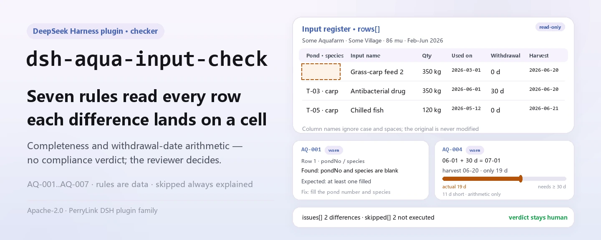
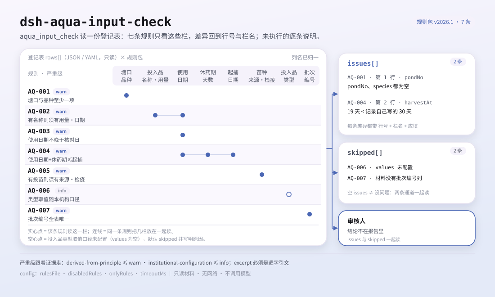

<div align="center">

<picture>
  <source media="(prefers-color-scheme: dark)" srcset="docs/assets/dsh-aqua-input-check-hero-en-dark.webp">
  
</picture>

# dsh-aqua-input-check

**जलकृषि आदान रजिस्टर की पूर्णता और प्रतीक्षा-अवधि तिथि-गणना की जाँच करता है — आपको मिलती है «कौन-सी पंक्ति, कौन-सा कॉलम, क्या कमी है» की सूची; निर्णय समीक्षक के पास रहता है।**

DeepSeek Harness के लिए एक डेटा-ओनली जाँच प्लगइन: एक आदान रजिस्टर पढ़ता है (फ़ार्म हेडर और हर प्रविष्टि की एक पंक्ति), साथ में आया संस्करणित नियम-पैक (AQ-001..AQ-007) लागू करता है, और सामग्री के भीतर उन्हीं अंतरों को सूचीबद्ध करता है जिन्हें वह इंगित कर सकता है — कभी कोई अनुपालन-निर्णय नहीं, कभी कोई उत्तरदायित्व-निर्धारण नहीं।

[इंस्टॉल](#तीन-चरणों-में-शुरुआत) · [कॉन्फ़िगरेशन](#कॉन्फ़िगरेशन) · [FAQ](#faq) · [简体中文](README.md) · [English](README.en.md) · [Español](README.es.md) · [Português](README.pt.md) · [हिन्दी](README.hi.md)

[](LICENSE)
[](#संगतता)
[](https://www.npmjs.com/package/dsh-aqua-input-check)
[](https://github.com/PerryLink/dsh-aqua-input-check/actions/workflows/ci.yml)
[](#संगतता)

[](https://github.com/PerryLink/dsh-aqua-input-check/stargazers)
[](https://www.npmjs.com/package/dsh-aqua-input-check)
[](https://dshfind.com/plugins/PerryLink/dsh-aqua-input-check?ref=badge)
[](https://securityscorecards.dev/viewer/?uri=github.com/PerryLink/dsh-aqua-input-check)
[](https://dsh.market/)
[](https://gitee.com/perrylink/dsh-aqua-input-check)

```sh
dsh plugin --profile <name> add dsh-aqua-input-check
```

</div>

<sub>सामुदायिक प्लगइन, DeepSeek से असंबद्ध। आधिकारिक रेपो: <https://github.com/PerryLink/dsh-aqua-input-check> (Gitee एक मिरर है)।</sub>

## यह क्या है

`dsh-aqua-input-check` जलकृषि आदानों का एक रजिस्टर पढ़ता है — फ़ार्म हेडर और प्रत्येक आदान प्रविष्टि की एक पंक्ति — और उसी रजिस्टर की पूर्णता तथा तिथि-गणना की जाँच करता है: क्या प्रत्येक प्रविष्टि में उसका तालाब और जाति दर्ज है, क्या नाम दर्ज होने पर आदान की मात्रा और उपयोग की तिथि दर्ज है, क्या उपयोग की तिथि भविष्य की नहीं है, क्या कटाई रजिस्टर में लिखी प्रतीक्षा-अवधि का पालन करती है, क्या पालन-प्रविष्टि में स्रोत और संगरोध प्रमाणपत्र संख्या दर्ज है, क्या आदान का प्रकार आपकी कॉन्फ़िगर की गई शब्दावली से है, और क्या बैच संख्याएँ अद्वितीय हैं।

यह तय नहीं करता कि पालन पद्धति नियमों के अनुरूप है, उत्पाद खाने के लिए सुरक्षित है, दवा उचित थी, या कोई दंड बनता है।

- **किसके लिए है**: जलकृषि फ़ार्म के रिकॉर्ड रखने वाले; कमांड लाइन की ज़रूरत नहीं — सामग्री चैट में सौंप दीजिए।
- **आप क्या देते हैं**: वह मूल सामग्री जिस पर जाँच चलती है (तालिका, रजिस्टर या दस्तावेज़); मूल कभी नहीं बदला जाता। Excel को पहले JSON/YAML में बदला जा सकता है, प्लेटफ़ॉर्म समर्थन करे तो चैट में ही।
- **आपको क्या मिलता है**: «कौन-सी पंक्ति, कौन-सा कॉलम, क्या कमी है, कैसे सुधारें» की सूची; जो जाँच चल नहीं पाई वह `skipped` में कारण सहित दर्ज होती है।

<picture>
  <source media="(prefers-color-scheme: dark)" srcset="docs/assets/dsh-aqua-input-check-flow-v5-dark.svg">
  
</picture>

## तीन चरणों में शुरुआत

1. **इंस्टॉल करें** (कोई एक चैनल चुनें):

   ```sh
   # git चैनल (नवीनतम main; git+https://github.com/PerryLink/dsh-aqua-input-check.git के समतुल्य)
   dsh plugin --profile <name> add github:PerryLink/dsh-aqua-input-check
   # npm चैनल (प्रकाशित संस्करण)
   dsh plugin --profile <name> add dsh-aqua-input-check
   # tarball चैनल: इस रेपो में pnpm pack करके, फिर
   dsh plugin --profile <name> add ./dsh-aqua-input-check-<version>.tgz
   ```

2. **न्यूनतम कॉन्फ़िग** (डिफ़ॉल्ट पर भी चलता है; बिना `config` वाली bundle पंक्ति सभी डिफ़ॉल्ट लेती है और नियम-पैक का पथ साथ आए `rules/aqua-input-check.yaml` की ओर इशारा करता है):

   ```yaml
   - insert:
       - id: dsh-aqua-input-check
         name: dsh-aqua-input-check
   ```

3. **सत्यापित करें कि माउंट हुआ**:

   ```sh
   dsh --profile <name> --dump-config | grep 'dsh-aqua-input-check'
   ```

   फिर उसे एक रजिस्टर दीजिए — उदाहरण के लिए रेपो में आई नमूना फ़ाइल (अपेक्षित आउटपुट `samples/quickstart/expected/result.json` में):

   ```text
   > साथ आए नमूने पर यह जाँच चलाओ और बताओ कितने निष्कर्ष मिले और किस स्तर के।
   aqua_input_check: 1 issue(s) — warn 1 (AQ-001: तालाब व जाति कॉलम खाली); skipped: 2
   ```

**अनइंस्टॉल**: `dsh plugin --profile <name> remove dsh-aqua-input-check` (या प्रोफ़ाइल पैच से वह पंक्ति हटा दें)।

<details>
<summary>WorkBuddy / Coze में उपयोग</summary>

WorkBuddy / Coze में «Professional Document Check Suite» खोजें (पूरा सेट; यह जाँच उसका एक हिस्सा है; उपलब्धता स्टोर सूची के अनुसार) — वही जाँच क्षमता बिना कमांड लाइन के मिल जाती है।

</details>

<details>
<summary>DSH Desktop मार्केट से इंस्टॉल करें</summary>

सभी PerryLink प्लगइन DSH Desktop के अंतर्निहित मार्केट में ब्राउज़ किए जा सकते हैं: **मार्केट → स्रोत → स्रोत जोड़ें → यह पेस्ट करें** `https://perrylink-dsh-catalog.perrylink.workers.dev/catalog-source.json` **→ चुनें**। इंस्टॉल के लिए मार्केट की npm पहचान जाँच और आपकी पुष्टि आवश्यक रहती है।

</details>

## मुख्य क्षमताएँ

`dsh-aqua-input-check` उपकरण `aqua_input_check` पंजीकृत करता है: एक आदान रजिस्टर पढ़ता है, संस्करणित नियम-पैक लागू करता है और एक रिपोर्ट लौटाता है।

- **एक डेटा पैक में सात नियम** — नियम-पैक कोड नहीं, डेटा है (`rules/aqua-input-check.yaml`); उसे बदलने से पूरा नियम-सेट बदल जाता है, TypeScript की एक भी पंक्ति छुए बिना।
- **सामग्री पर केवल-पठन** — JSON या YAML स्वीकार करता है और मूल कभी नहीं बदलता; शुद्ध ESM, कोई नेटवर्क अनुरोध नहीं, कोई मॉडल कॉल नहीं।
- **कोई गढ़ा हुआ उद्धरण नहीं** — हर नियम में `document` / `number` / `clause` / `excerpt` / `kind` / `source` होता है; `excerpt` शब्दशः उद्धरण होना चाहिए, और जिन नियमों का खंड-पाठ इस बार नहीं मिला वे स्वयं `excerpt` में यह कहते हैं और `derived-from-principle` ही रहते हैं।
- **गंभीरता साक्ष्य के अनुसार** — `derived-from-principle` की अधिकतम सीमा `warn`, संस्थागत कॉन्फ़िगरेशन (`institutional-configuration`) की `info`; एक टेस्ट इसे लागू करता है।
- **खाली सूची कभी «सब ठीक» नहीं** — जो जाँच नहीं चल पाई वह कारण सहित `skipped` में दर्ज होती है; अपेक्षित सूची सेट न होने वाला नियम चुपचाप पास होने के बजाय स्वयं को `skipped` में बताता है।
- **निर्णय करने वाली भाषा नहीं** — रिपोर्ट केवल अंतर सूचीबद्ध करती है; अनुपालन, उत्तरदायित्व या शुद्धता पर कभी टिप्पणी नहीं। वर्डिंग गार्ड इसे लागू करता है और हर रिपोर्ट में अस्वीकरण रहता है।

| नियम | जाँच | गंभीरता | आधार प्रकार |
|---|---|---|---|
| `AQ-001` | तालाब और जाति दर्ज हैं | warn | principle |
| `AQ-002` | नाम वाला आदान मात्रा और तिथि दर्ज करता है | warn | principle |
| `AQ-003` | उपयोग की तिथि भविष्य की नहीं है | warn | principle |
| `AQ-004` | कटाई दर्ज प्रतीक्षा-अवधि का पालन करती है | warn | principle |
| `AQ-005` | पालन-प्रविष्टि में स्रोत और संगरोध संख्या दर्ज है | warn | principle |
| `AQ-006` | आदान प्रकार आपकी शब्दावली से है (डिफ़ॉल्ट रूप से बंद) | info | local |
| `AQ-007` | बैच संख्याएँ अद्वितीय हैं | warn | principle |

### उदाहरण

ये प्लगइन के वास्तविक प्रवेश-बिंदु हैं; एक बार इंस्टॉल करें, फिर कोई एक चलाएँ। नीचे की तालिका की पहली पंक्ति विस्तृत केस है, बाकी संक्षिप्त केस हैं।

**विस्तृत उदाहरण** — उपकरण `aqua_input_check`, इनपुट:

```json
{"rows":[{"序号":"1","塘口编号":"","养殖品种":"","投苗日期":"2026-02-20", ...}]}
```

आउटपुट:

```json
{
  "id": "dsh-aqua-input-check.AQ-001.de09b5a6",
  "ruleId": "AQ-001",
  "severity": "warn",
  "locator": {
    "row": 1,
    "field": "pondNo"
  },
  "found": "第 1 行 pondNo、species 都为空",
  "expected": "pondNo、species 至少应填写一项",
  "fix": "补填塘口编号与养殖品种；本条只核对是否填写"
}
```

*स्रोत `dsh-aqua-input-check/tests/fixtures/AQ-001/AQ-001-unsafe.json; dsh-aqua-input-check/tests/fixtures/AQ-001/cases.json; dsh-aqua-input-check/rules/aqua-input-check.yaml; dsh-aqua-input-check/tests/index.test.ts`*

| आपका सवाल | इसका जवाब |
|---|---|
| एक प्रविष्टि में आदान का नाम है, पर तालाब और जाति के कॉलम खाली हैं। | `AQ-001` हर प्रविष्टि में `pondNo` और `species` में से कम से कम एक की अपेक्षा करता है। यह केवल देखता है कि दोनों में से एक भरा है, और यह नहीं आँकता कि वह आदान उस जाति के लिए उपयुक्त है। |
| आदान का नाम भरा है, पर मात्रा और उपयोग की तिथि खाली हैं। | `AQ-002` तब `inputQty` और `usedAt` की अपेक्षा करता है जब `inputName` भरा हो। यह देखता है कि ये कॉलम दर्ज हैं, यह नहीं कि मात्रा उचित है या दवा रोग के अनुरूप है। |
| उपयोग की तिथि `15/03/2026` लिखी है, और एक पंक्ति में अगले महीने की तिथि है। | `AQ-003` `2026-03-15` और `2026-03-15 09:30` दोनों रूप पढ़ता है; जो `usedAt` पढ़ा न जा सके वह अलग से दर्ज होता है, और जाँच-तिथि से आगे की तिथि भविष्य की तिथि के रूप में दर्ज होती है। यह प्रतीक्षा-अवधि को नहीं छूता — इस रूल पैक में कोई प्रतीक्षा-अवधि दिन ही शामिल नहीं है। |
| 1 जून को दवा दी, प्रतीक्षा-अवधि 20 दिन दर्ज है, और 15 जून को कटाई कर ली — क्या यह पकड़ में आता है? | हाँ। `AQ-004` `usedAt`, `harvestAt` और रजिस्टर में लिखे `withdrawalDays` की तुलना करता है और जितने दिन कम हैं उतने दर्ज करता है। इसका मतलब है «आपकी दर्ज प्रतीक्षा-अवधि के अनुसार कटाई जल्दी हो गई», यह नहीं कि उत्पाद असुरक्षित है — अवशेष की जाँच का परिणाम चाहिए, जो यह प्लगइन देख नहीं सकता। तीनों कॉलम भरे और पढ़ने योग्य न हों तो यह नियम कोई अवधि मान लेने के बजाय `skipped` दर्ज करता है। |
| हम जो आदान प्रकार इस्तेमाल करते हैं वह सूची में नहीं है, और कुछ भी दर्ज नहीं हुआ। | `AQ-006` `skipped` दर्ज करता है क्योंकि इस रूल पैक के साथ कोई आदान-प्रकार सूची नहीं आती: `values` तब तक खाली रहता है जब तक आप उसे कॉन्फ़िगर न करें। कॉन्फ़िगर होने पर यह देखता है कि दर्ज `inputType` आपके दिए मानों में से है। यह नहीं आँकता कि वह आदान उपयोग के लिए अनुमत है — उसके लिए प्रतिबंधित दवाओं की सूची और उत्पाद का अनुमोदन क्रमांक चाहिए। |
| एक ही बैच संख्या दो पंक्तियों में आई है। | `AQ-007` दोहराव दर्ज करता है और दोनों पंक्तियाँ बताता है। तुलना में रिक्त स्थान छोड़ दिए जाते हैं; एक ही बैच की कई आदान प्रविष्टियाँ सामान्य हैं बशर्ते वे वही बैच संख्या साझा करें — पंक्ति-संख्या कॉलम को इसके लिए दोबारा इस्तेमाल न करें। बैच संख्या कॉलम न हो तो यह चुपचाप पास होने के बजाय बताता है कि वह चल नहीं सका। |

## यह किन मानकों पर आधारित है

| दस्तावेज़ | संख्यांक | इन्हें उद्धृत करने वाले नियम |
|---|---|---|
| 《水产养殖质量安全管理规定》 | 农业部令（现行令号与条号本次未核实） | AQ-001, AQ-002, AQ-005, AQ-007 |
| 《绿色食品 渔药使用准则》 | NY/T 755—2022（2022-07-11 发布、2022-10-01 实施；全部代替已废止的 NY/T 755—2013；属绿色食品系列标准；条号本次未取得） | AQ-003, AQ-004 |
| 本机构养殖生产管理口径（本机构配置） | 无统一标准（本条依据为本机构配置的类型口径） | AQ-006 |

**सीमा:** यह प्लगइन एक **जलकृषि आदान रजिस्टर** की पूर्णता और तिथि-गणना की जाँच करता है — क्या प्रत्येक प्रविष्टि में तालाब और जाति दर्ज है, क्या नाम वाला आदान मात्रा और उपयोग की तिथि दर्ज करता है, क्या उपयोग की तिथि भविष्य की नहीं है, क्या कटाई रजिस्टर में लिखी प्रतीक्षा-अवधि का पालन करती है, क्या पालन-प्रविष्टि में स्रोत और संगरोध प्रमाणपत्र दर्ज है, क्या आदान प्रकार आपकी कॉन्फ़िगर की गई शब्दावली से है, और क्या बैच संख्याएँ अद्वितीय हैं। यह तय **नहीं** करता कि पालन पद्धति अनुपालन में है, उत्पाद खाने लायक है, दवा उचित थी, या कोई दंड बनता है।

> ### ⚠️ रिपोर्ट के किसी उद्धरण पर भरोसा करने से पहले यह पढ़ें
>
> **हर `excerpt` की स्थिति नियम-दर-नियम है, एक समान नहीं।** कुछ नियम खंड का शब्दशः उद्धरण देते हैं (`kind: direct`), कुछ उद्धृत अनुच्छेदों के सिद्धांत से निकाले गए हैं (`kind: derived-from-principle`, अधिकतम `warn`), और कुछ आपकी संस्था के कॉन्फ़िगर किए गए सीमा-मान इस्तेमाल करते हैं (`kind: institutional-configuration`, अधिकतम `info`)। पैक कभी उद्धरण का भावार्थ नहीं बदलता: पाठ न मिलने पर `excerpt` फ़ील्ड स्वयं यह कहता है और तर्क `note` में रहता है; एक टेस्ट सुनिश्चित करता है कि कोई नियम ऐसे उद्धरण का दावा न करे जो उसके पास नहीं है।**जो नियम अभी भी «पाठ प्राप्त नहीं» के चिह्नित हैं, पाठ मिलते ही उनका `excerpt` वास्तविक खंड से बदलें और `kind` को `direct` करें।**
>
> निष्कर्ष समीक्षक का है: यह प्लगइन सामग्री के भीतर इंगित किए जा सकने वाले अंतर सूचीबद्ध करता है, तथ्य या अनुपालन पर फैसला नहीं करता।

## कॉन्फ़िगरेशन

सभी समायोज्य पैरामीटर `src/config.ts` के Schemastery `Config` फ़ील्ड हैं (cordis.yml से बदले जा सकते हैं); प्रति-नियम सीमाएँ `rules/` के नियम-पैक में हैं। id पर आधारित ओवरराइड पूरी पंक्ति बदल देता है — जो कुंजियाँ चाहिए वे सब दोहराएँ।

| कुंजी | प्रकार | डिफ़ॉल्ट | विवरण |
|---|---|---|---|
| `rulesFile` | string | `rules/aqua-input-check.yaml` | नियम-पैक का पथ, पैकेज रूट के सापेक्ष |
| `disabledRules` | string[] | `[]` | बंद करने वाले नियम id; प्रत्येक `skipped` में दिखता है |
| `onlyRules` | string[] | `[]` | केवल ये नियम चलाएँ; खाली होने पर सभी नियम चलते हैं |
| `skipNotes` | string | `""` | हर `skipped` कारण के आगे जोड़ी जाने वाली टिप्पणी |
| `timeoutMs` | number | `120000` | उपकरण का सहकारी समय-सीमा बजट |

जानने योग्य नियम-स्तरीय पैरामीटर:

- `AQ-004` `earlierField` / `laterField` / `minDaysField` — दो तिथियाँ और अपेक्षित अंतराल रखने वाला कॉलम। अवधि स्वयं रिकॉर्ड से आती है, इसलिए कोई संख्या अंतर्निहित नहीं है।
- `AQ-006` `values` — आपके आदान प्रकार, उदाहरण `[मिश्रित फ़ीड, ताज़ा मछली, जल-गुणवत्ता सुधारक, जीवाणुरोधी, परजीवीरोधी, कीटाणुनाशक, टीका]`। खाली होने पर कोई जाँच नहीं।
- `AQ-002` `conditionField` / `requiredFields` — मात्रा-और-तिथि अपेक्षा कब सक्रिय होती है।

आपके प्रोफ़ाइल पैच में ओवरराइड उदाहरण:

```yaml
- insert:
    - id: dsh-aqua-input-check
      name: dsh-aqua-input-check
      config:
        disabledRules: [AQ-007]
        timeoutMs: 180000
```

## सामग्री प्रारूप

उपकरण JSON या YAML स्वीकार करता है:

```yaml
farm: 某某水产养殖场
site: 某某镇某某村
area: 86 亩
rows:
  - { 序号: '1', 批次编号: B-2026-0001, 塘口编号: T-03, 养殖品种: 草鱼,
      投苗日期: 2026-02-20, 苗种来源: 某某苗种场, 检疫证号: JY-2026-0031,
      投入品类型: 配合饲料, 投入品名称: 草鱼配合饲料 2 号, 投入量: '350',
      投入量单位: kg, 使用日期: 2026-03-01, 休药期天数: '0', 起捕日期: 2026-06-20 }
```

कॉलम नामों की तुलना बड़े-छोटे अक्षरों की परवाह किए बिना, और रिक्त स्थान, अंडरस्कोर व हाइफन छोड़कर होती है; रजिस्टर के अपने कॉलम नाम बने रहते हैं, इसलिए निष्कर्ष उसी कॉलम का नाम बताता है जिसे पढ़ा गया। ध्यान दें कि पंक्ति-क्रम कॉलम पंक्ति की प्रदर्शन संख्या के रूप में पढ़ा जाता है — बैच पहचानकर्ता को अपना अलग कॉलम दें। पढ़ने की परत में फ़ील्ड वैकल्पिक हैं और जाँच इंजन उन्हें सत्यापित करता है, इसलिए आंशिक निर्यात पर क्रैश के बजाय «अनुपस्थित मद» निष्कर्ष मिलते हैं।

## नियमों के स्रोत

नियम-डेटा `rules/aqua-input-check.yaml` में रहता है, कोड से अलग: प्रत्येक नियम में दस्तावेज़, संख्या, स्रोत की अपनी क्रमांकन-प्रणाली के अनुसार खंड, शब्दशः उद्धरण और स्रोत URL होता है। पैक का हेडर इस बार की उद्धरण-कमी पूरी तरह बताता है, और हर नियम का `note` उससे जुड़ा भाग दोहराता है। लोड-टाइम गार्ड जो सामान्यतः लागू करता है कि «उद्धरण कम से कम आठ अक्षरों का वास्तविक उद्धरण हो», उद्धरण और विवरण में अंतर नहीं कर सकता — इसलिए यह पैक हेडर, प्रति-नियम नोट और एक ऐसे टेस्ट पर टिकता है जो दावा करता है कि हर `excerpt` उस कमी को स्वीकारता है। अपना आधार बढ़ा-चढ़ाकर बताने वाला पैक आत्मविश्वास भरी रिपोर्ट बनाने के बजाय लोड समय पर ही विफल होता है। सत्यापन में पुष्टि हुई सीमाएँ और जान-बूझकर **न** निकाले गए निष्कर्ष साथ आए `rules/evidence/` डायरेक्टरी में हैं।

## FAQ

<details>
<summary>क्या यह हमारे लिए अनुपालन का फैसला करता है?</summary>

नहीं। यह केवल सामग्री के भीतर इंगित किए जा सकने वाले अंतर सूचीबद्ध करता है (कौन-सी पंक्ति, कौन-सा कॉलम, क्या कमी है, कैसे सुधारें) और तथ्य या अनुपालन पर फैसला नहीं करता — निष्कर्ष हमेशा समीक्षक के पास रहता है। वर्डिंग गार्ड रिपोर्ट की भाषा लागू करता है और हर रिपोर्ट में अस्वीकरण रहता है।

</details>

<details>
<summary>मेरा रजिस्टर Excel में है। क्या सीधे इस्तेमाल हो सकता है?</summary>

हाँ — पहले उसे JSON या YAML में बदलें; प्लेटफ़ॉर्म समर्थन करे तो चैट में ही रूपांतरण हो सकता है। उपकरण सामग्री केवल पढ़ता है और मूल कभी नहीं बदलता।

</details>

<details>
<summary>`AQ-006` कभी कुछ क्यों नहीं बताता?</summary>

क्योंकि इस रूल पैक के साथ कोई आदान-प्रकार सूची नहीं आती: `values` डिफ़ॉल्ट रूप से खाली है, इसलिए नियम स्वयं को `skipped` में बताता है। `values` में अपने फ़ार्म के आदान प्रकार भरने के बाद नियम यह देखने लगता है कि दर्ज प्रकार उन्हीं में से है; फिर भी यह नहीं आँकता कि वह आदान उपयोग के लिए अनुमत है।

</details>

<details>
<summary>क्या खाली `issues` सूची को «कुछ गलत नहीं» पढ़ा जा सकता है?</summary>

नहीं। जो जाँच नहीं चल पाई वह कारण सहित `skipped` में दर्ज होती है (तिथि अनुपस्थित, प्रतीक्षा-अवधि अनुपस्थित, शब्दावली सेट नहीं)। रिपोर्ट से कोई निष्कर्ष निकालने से पहले `issues` और `skipped` दोनों साथ पढ़ें।

</details>

<details>
<summary>क्या पूरे सीज़न के रिकॉर्ड एक साथ संभल पाएगा?</summary>

उपकरण `native` और `ptc` दोनों मोड में चलता है; बैच काम (पूरे सीज़न के रिकॉर्ड या पूरा फ़ोल्डर) के लिए `ptc` चुनें, जहाँ स्कीमा लागत एक ही बार लगती है। जाँच स्वयं स्थानीय कॉलम-मिलान और तिथि-गणना है — कोई नेटवर्क अनुरोध नहीं, कोई मॉडल कॉल नहीं; `timeoutMs` (डिफ़ॉल्ट 120 सेकंड) सहकारी समय-सीमा बजट है।

</details>

## समस्या निवारण

- **`AQ-004` स्वयं को `skipped` बताता है।** दोनों तिथियों या प्रतीक्षा-अवधि में से एक अनुपस्थित है। उदाहरण के लिए केवल खिलाने वाली, बिना कटाई वाली प्रविष्टियाँ इसके दायरे से बाहर हैं।
- **`AQ-004` चला पर मेरा मानना है कि बैच सुरक्षित है।** निष्कर्ष गणना है: **आपके दर्ज** अवधि के अनुसार कटाई जल्दी हुई। अवशेष समस्या है या नहीं, यह जाँच-परिणाम ही बताएगा।
- **`AQ-006` कभी नहीं चलता।** उसकी शब्दावली खाली है; उसमें अपने फ़ार्म के आदान प्रकार भरें।
- **`AQ-007` कई प्रविष्टियों वाले बैच पर चल पड़ा।** एक ही बैच की कई प्रविष्टियों को वही बैच संख्या साझा करनी चाहिए। यदि आपका रजिस्टर हर पंक्ति को नंबर देता है, तो नियम बंद करें या कोई अलग पहचान कॉलम इस्तेमाल करें।
- **प्लगइन इंस्टॉल हो गया पर टूल दिखता नहीं।** जाँचें कि `main` `lib/index.mjs` पर जाता है और `pnpm run build` ने उसे बनाया है; गलत `main` लोडर को उस प्रविष्टि को चुपचाप छोड़ने पर मजबूर कर देता है।
- **`dsh plugin add` असंगत बताकर मना करता है।** peer रेंज `0.1.x` और `0.2.x` दोनों को कवर करती है; रनटाइम उसके बाहर हो तो स्पष्ट छूट दें: `dsh plugin --profile <name> allow-version dsh-aqua-input-check@0.1.0 --dsh-version <runtime> --accept-risk`
- **`check` में `manifest-peers` विफल दिखता है।** स्टैटिक चेकर 0.2 लाइन से पहले की हार्ड-कोडेड peer रेंज से तुलना करता है। इंस्टॉल के समय अनुकूलता रनटाइम लागू करता है, इसलिए घोषित रेंज ही सही है; यह `dsh-plugin-dev` की ज्ञात अपस्ट्रीम समस्या है।
- **समय खिसका हुआ लगता है।** सारी गणना दिए गए स्ट्रिंग पर वॉल-क्लॉक है, कोई टाइमज़ोन रूपांतरण नहीं।

## संगतता

| सतह | स्थिति |
|---|---|
| Harness | peer रेंज `>=0.1.2-rc.1 <0.2.0 \|\| >=0.2.0-0 <0.3.0` — `0.2.0-rc.2` और `0.2.1-rc.2` दोनों को स्वीकार करने के लिए सत्यापित। `engines.dsh` `>=0.2.1-0 <0.3.0` के रूप में घोषित है और 0.2.1 से होस्ट इसे लागू करता है |
| Node | `^22.19.0 \|\| >=24.0.0` |
| प्लेटफ़ॉर्म | सभी (शुद्ध ESM; कोई नेटिव कोड नहीं, कोई नेटवर्क नहीं, कोई मॉडल कॉल नहीं) |
| टूल मोड | `native` और `ptc` में काम करता है; पूरे फ़ोल्डर के लिए `ptc` चुनें |

## इकोसिस्टम और गुणवत्ता

- [Gitee मिरर](https://gitee.com/perrylink/dsh-aqua-input-check) (सिंक मिरर; GitHub ही आधिकारिक है)
- [dshfind प्लगइन पेज](https://dshfind.com/plugins/PerryLink/dsh-aqua-input-check) (इंस्टॉल और रैंकिंग)
- [OpenSSF Scorecard रिपोर्ट](https://securityscorecards.dev/viewer/?uri=github.com/PerryLink/dsh-aqua-input-check) ([.github/workflows/scorecard.yml](.github/workflows/scorecard.yml) से संचालित)
- [DSH Market](https://dsh.market/) (सूचीबद्ध)
- **1024 स्टोर चैनल**: एक बार `npm i -g dsh1024`, फिर `dsh1024 plugin --profile <name> add dsh-aqua-input-check` ([deepseek1024.com](https://deepseek1024.com) इंस्टॉल रैंकिंग में गिना जाता है)
- [इकोसिस्टम नॉलेज बेस](https://perrylink.github.io/dsh-plugin-guide/) — प्लगइन विकास गाइड · चयन के मापे गए डेटा · रखरखाव मानदंड

## डेवलपमेंट

```sh
pnpm install                                        # node ^22.19 || >=24
pnpm run typecheck                                  # tsc --noEmit
pnpm test                                           # vitest: साझा टेबल-प्लगइन सूट + जुड़े फ़िक्स्चर
pnpm run build                                      # tsdown -> lib/index.mjs + lib/index.d.mts
pnpm run verify:self-contained                      # डिपेंडेंसी स्पेक रजिस्ट्री से हल होती हैं
pnpm run check:lockfile                             # lockfile ड्रिफ़्ट जाँच
pnpm run check:readmes                              # पाँचों भाषाओं के README की एकरूपता
pnpm run check:citations                            # नियम-पैक उद्धरण बेसलाइन
node ../scripts/sync-shared.mjs dsh-aqua-input-check   # ../_shared से src/shared ताज़ा करें
pnpm pack                                           # प्रकाशित tarball
```

यह प्लगइन **डेटा-ओनली** है: `src/model.ts` तालिका की आकृति घोषित करता है, साझा किट रीडर और जाँच इंजन देती है, और नियम-पैक हर जाँच घोषित करता है। स्थानीय नमूना रन (पहले `pnpm run build` से `lib/` बनाना ज़रूरी):

```sh
node samples/quickstart/run.mjs --json
# => {"tool":"aqua_input_check","issueCount":1,"summary":{"error":0,"warn":1,"info":0},"skippedCount":2}
```

नमूना इनपुट `samples/quickstart/input/` में, अपेक्षित आउटपुट `samples/quickstart/expected/result.json` में, और स्क्रीनशॉट `docs/assets/quickstart.png` में है। README की छवियाँ [`scripts/gen-readme-assets.py`](scripts/gen-readme-assets.py) से प्रोग्रामेटिक रूप में बनती हैं (hero बैनर के लिए Pillow, संरचना चित्र के लिए हाथ से लिखा SVG) और स्क्रिप्ट दोबारा चलाई जा सकती है; पुराना एकल-स्किन फ़्लो चित्र और डेमो छवियाँ बाहरी लिंक के लिए `docs/assets/` में बनी रहती हैं, जबकि README केवल नए hero और flow-v5 संरचना चित्रों को संदर्भित करते हैं, दोनों हल्के और गहरे रूप में।

Topics: `deepseek-harness`, `dsh`, `dsh-plugin`, `cordis`, `aqua`, `input`

## परिवार और आभार

यह प्रोजेक्ट [PerryLink](https://github.com/PerryLink) के DeepSeek Harness प्लगइन परिवार का हिस्सा है (सभी Apache-2.0)। पूरा पारिवारिक सूचकांक: [सामग्री के अनुसार चेकर चुनें](https://perrylink.github.io/zh/checkers/choose/) और [सभी प्लगइन](https://github.com/PerryLink)। यदि यह उपयोगी लगे, तो **एक स्टार अगले व्यक्ति को इसे खोजने में मदद करता है** — इसके पीछे कुछ भी बंद नहीं है।

- [@PerryLink](https://github.com/PerryLink) — निर्माता और रखरखावकर्ता: डेटा-ओनली नियम-पैक (AQ-001..AQ-007), `aqua_input_check` उपकरण, उद्धरण-सत्यापन अभिलेख और पाँच-भाषा दस्तावेज़।

<details>
<summary>सभी प्लगइन खोलें</summary>

| प्लगइन | स्थिति |
|---|---|
| **[dsh-aqua-input-check](https://github.com/PerryLink/dsh-aqua-input-check)** |  |
| **[dsh-archive-check](https://github.com/PerryLink/dsh-archive-check)** |  |
| **[dsh-auto-review](https://github.com/PerryLink/dsh-auto-review)** |  |
| **[dsh-autotier](https://github.com/PerryLink/dsh-autotier)** | 🧊 फ़्रोज़न — रेपो README देखें |
| **[dsh-bid-ca-precheck](https://github.com/PerryLink/dsh-bid-ca-precheck)** |  |
| **[dsh-bid-qual-check](https://github.com/PerryLink/dsh-bid-qual-check)** |  |
| **[dsh-cert-mcp](https://github.com/PerryLink/dsh-cert-mcp)** | 🧊 फ़्रोज़न — रेपो README देखें |
| **[dsh-checkpoint-rewind](https://github.com/PerryLink/dsh-checkpoint-rewind)** |  |
| **[dsh-click](https://github.com/PerryLink/dsh-click)** |  |
| **[dsh-composer-history](https://github.com/PerryLink/dsh-composer-history)** |  |
| **[dsh-contract-stance](https://github.com/PerryLink/dsh-contract-stance)** |  |
| **[dsh-customs-doc-check](https://github.com/PerryLink/dsh-customs-doc-check)** |  |
| **[dsh-data-quality](https://github.com/PerryLink/dsh-data-quality)** | 🧊 फ़्रोज़न — रेपो README देखें |
| **[dsh-demurrage-ledger](https://github.com/PerryLink/dsh-demurrage-ledger)** |  |
| **[dsh-doublecheck](https://github.com/PerryLink/dsh-doublecheck)** |  |
| **[dsh-drill-script-check](https://github.com/PerryLink/dsh-drill-script-check)** |  |
| **[dsh-eia-guide-check](https://github.com/PerryLink/dsh-eia-guide-check)** |  |
| **[dsh-emergency-plan](https://github.com/PerryLink/dsh-emergency-plan)** |  |
| **[dsh-essay-rubric-check](https://github.com/PerryLink/dsh-essay-rubric-check)** |  |
| **[dsh-evidence-check](https://github.com/PerryLink/dsh-evidence-check)** |  |
| **[dsh-export-ctl-check](https://github.com/PerryLink/dsh-export-ctl-check)** |  |
| **[dsh-fast](https://github.com/PerryLink/dsh-fast)** |  |
| **[dsh-fmea-table-check](https://github.com/PerryLink/dsh-fmea-table-check)** |  |
| **[dsh-forecast-penalty](https://github.com/PerryLink/dsh-forecast-penalty)** |  |
| **[dsh-fund-research](https://github.com/PerryLink/dsh-fund-research)** |  |
| **[dsh-github](https://github.com/PerryLink/dsh-github)** |  |
| **[dsh-gongwen-flow-check](https://github.com/PerryLink/dsh-gongwen-flow-check)** |  |
| **[dsh-gongwen-word-check](https://github.com/PerryLink/dsh-gongwen-word-check)** |  |
| **[dsh-guard-plan-qc](https://github.com/PerryLink/dsh-guard-plan-qc)** |  |
| **[dsh-hazchem-check](https://github.com/PerryLink/dsh-hazchem-check)** |  |
| **[dsh-hazplan-check](https://github.com/PerryLink/dsh-hazplan-check)** |  |
| **[dsh-hidden-risk-map](https://github.com/PerryLink/dsh-hidden-risk-map)** |  |
| **[dsh-hs-classify](https://github.com/PerryLink/dsh-hs-classify)** |  |
| **[dsh-icd-rule-check](https://github.com/PerryLink/dsh-icd-rule-check)** |  |
| **[dsh-industry-research](https://github.com/PerryLink/dsh-industry-research)** |  |
| **[dsh-lawcite-adapter](https://github.com/PerryLink/dsh-lawcite-adapter)** |  |
| **[dsh-laya](https://github.com/PerryLink/dsh-laya)** |  |
| **[dsh-lc-doc-check](https://github.com/PerryLink/dsh-lc-doc-check)** |  |
| **[dsh-learning-gap-check](https://github.com/PerryLink/dsh-learning-gap-check)** |  |
| **[dsh-library](https://github.com/PerryLink/dsh-library)** |  |
| **[dsh-local-ai](https://github.com/PerryLink/dsh-local-ai)** |  |
| **[dsh-lsp-actions](https://github.com/PerryLink/dsh-lsp-actions)** |  |
| **[dsh-mask](https://github.com/PerryLink/dsh-mask)** |  |
| **[dsh-mcp-panel](https://github.com/PerryLink/dsh-mcp-panel)** |  |
| **[dsh-medrec-qc](https://github.com/PerryLink/dsh-medrec-qc)** |  |
| **[dsh-memento](https://github.com/PerryLink/dsh-memento)** | 🧊 फ़्रोज़न — रेपो README देखें |
| **[dsh-nsfc-form-check](https://github.com/PerryLink/dsh-nsfc-form-check)** |  |
| **[dsh-nurse-record-check](https://github.com/PerryLink/dsh-nurse-record-check)** |  |
| **[dsh-observe](https://github.com/PerryLink/dsh-observe)** |  |
| **[dsh-origin-rvc-check](https://github.com/PerryLink/dsh-origin-rvc-check)** |  |
| **[dsh-ota-review-check](https://github.com/PerryLink/dsh-ota-review-check)** |  |
| **[dsh-output-styles](https://github.com/PerryLink/dsh-output-styles)** |  |
| **[dsh-paper-doc-adapter](https://github.com/PerryLink/dsh-paper-doc-adapter)** |  |
| **[dsh-permission-rules](https://github.com/PerryLink/dsh-permission-rules)** |  |
| **[dsh-permit-report-check](https://github.com/PerryLink/dsh-permit-report-check)** |  |
| **[dsh-pipeline-check](https://github.com/PerryLink/dsh-pipeline-check)** |  |
| **[dsh-pleading-draft](https://github.com/PerryLink/dsh-pleading-draft)** |  |
| **[dsh-plugin-doctor](https://github.com/PerryLink/dsh-plugin-doctor)** | 🚫 रिटायर्ड (रेपो संग्रहीत) |
| **[dsh-plugin-guide](https://github.com/PerryLink/dsh-plugin-guide)** |  |
| **[dsh-plugin-kit](https://github.com/PerryLink/dsh-plugin-kit)** | 🚫 रिटायर्ड (रेपो संग्रहीत) |
| **[dsh-plugin-upgrade](https://github.com/PerryLink/dsh-plugin-upgrade)** | 🚫 रिटायर्ड (रेपो संग्रहीत) |
| **[dsh-policy-brief-draft](https://github.com/PerryLink/dsh-policy-brief-draft)** |  |
| **[dsh-power-loss-split](https://github.com/PerryLink/dsh-power-loss-split)** |  |
| **[dsh-power-ticket-check](https://github.com/PerryLink/dsh-power-ticket-check)** |  |
| **[dsh-ppap-check](https://github.com/PerryLink/dsh-ppap-check)** |  |
| **[dsh-protest-deadline](https://github.com/PerryLink/dsh-protest-deadline)** |  |
| **[dsh-railway-window](https://github.com/PerryLink/dsh-railway-window)** |  |
| **[dsh-repair-order-qc](https://github.com/PerryLink/dsh-repair-order-qc)** |  |
| **[dsh-research-report](https://github.com/PerryLink/dsh-research-report)** |  |
| **[dsh-review-reply-check](https://github.com/PerryLink/dsh-review-reply-check)** |  |
| **[dsh-rulefile-check](https://github.com/PerryLink/dsh-rulefile-check)** |  |
| **[dsh-safety-brief-check](https://github.com/PerryLink/dsh-safety-brief-check)** |  |
| **[dsh-score](https://github.com/PerryLink/dsh-score)** | 🧊 फ़्रोज़न — रेपो README देखें |
| **[dsh-session-sync](https://github.com/PerryLink/dsh-session-sync)** |  |
| **[dsh-site-log-check](https://github.com/PerryLink/dsh-site-log-check)** |  |
| **[dsh-skill-pack-security](https://github.com/PerryLink/dsh-skill-pack-security)** |  |
| **[dsh-soe-decision-check](https://github.com/PerryLink/dsh-soe-decision-check)** |  |
| **[dsh-soilwater-check](https://github.com/PerryLink/dsh-soilwater-check)** |  |
| **[dsh-sop-sync-check](https://github.com/PerryLink/dsh-sop-sync-check)** |  |
| **[dsh-spc-gbt-adapter](https://github.com/PerryLink/dsh-spc-gbt-adapter)** |  |
| **[dsh-talk](https://github.com/PerryLink/dsh-talk)** |  |
| **[dsh-tender-extract](https://github.com/PerryLink/dsh-tender-extract)** |  |
| **[dsh-tender-matrix](https://github.com/PerryLink/dsh-tender-matrix)** |  |
| **[dsh-test-drive](https://github.com/PerryLink/dsh-test-drive)** |  |
| **[dsh-ticktick](https://github.com/PerryLink/dsh-ticktick)** | 🚫 रिटायर्ड (रेपो संग्रहीत) |
| **[dsh-translate](https://github.com/PerryLink/dsh-translate)** |  |
| **[dsh-warranty-calc](https://github.com/PerryLink/dsh-warranty-calc)** |  |
| **[dsh-budget](https://github.com/PerryLink/dsh-budget)** | 🧊 फ़्रोज़न — रेपो README देखें |
| **[dsh-claude-move](https://github.com/PerryLink/dsh-claude-move)** | 🧊 फ़्रोज़न — रेपो README देखें |
| **[dsh-defend](https://github.com/PerryLink/dsh-defend)** | 🧊 फ़्रोज़न — रेपो README देखें |
| **[dsh-draw](https://github.com/PerryLink/dsh-draw)** | 🧊 फ़्रोज़न — रेपो README देखें |
| **[dsh-reach](https://github.com/PerryLink/dsh-reach)** | 🧊 फ़्रोज़न — रेपो README देखें |
| **[dsh-background-agents](https://github.com/PerryLink/dsh-background-agents)** | 🚫 रिटायर्ड (रेपो संग्रहीत) |
| **[dsh-session-pin](https://github.com/PerryLink/dsh-session-pin)** | 🚫 रिटायर्ड (रेपो संग्रहीत) |
| **[dsh-team-rooms](https://github.com/PerryLink/dsh-team-rooms)** | 🚫 रिटायर्ड (रेपो संग्रहीत) |

</details>

## लाइसेंस

[LICENSE](LICENSE) (Apache License 2.0) © 2026 dsh-aqua-input-check contributors

<p align="center"><sub>Apache-2.0 · सामुदायिक प्लगइन, DeepSeek से असंबद्ध।</sub></p>
