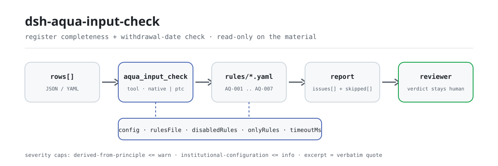

<div align="center">

<picture>
  <source media="(prefers-color-scheme: dark)" srcset="docs/assets/dsh-aqua-input-check-flow-dark.svg">
  
</picture>

# dsh-aqua-input-check

**核对水产养殖投入品记录的齐备与休药期日期算术——输出「哪一行、哪一栏、差什么」的清单，结论留给审核人。**

面向 DeepSeek Harness 的数据型核查插件：读取一份投入品记录（养殖场表头加每条记录一行），按随包的版本化规则包（AQ-001..AQ-007）逐条核对，只列材料内部能指认的差异，不判合规、不认定责任。

[安装](#三步上手) · [配置](#配置) · [FAQ](#faq) · [简体中文](README.md) · [English](README.en.md) · [Español](README.es.md) · [Português](README.pt.md) · [हिन्दी](README.hi.md)

[](LICENSE)
[](#兼容性)
[](https://www.npmjs.com/package/dsh-aqua-input-check)
[](https://github.com/PerryLink/dsh-aqua-input-check/actions/workflows/ci.yml)
[](#兼容性)

[](https://github.com/PerryLink/dsh-aqua-input-check/stargazers)
[](https://www.npmjs.com/package/dsh-aqua-input-check)
[](https://dshfind.com/plugins/PerryLink/dsh-aqua-input-check?ref=badge)
[](https://securityscorecards.dev/viewer/?uri=github.com/PerryLink/dsh-aqua-input-check)
[](https://dsh.market/)
[](https://gitee.com/perrylink/dsh-aqua-input-check)

```sh
dsh plugin --profile <name> add dsh-aqua-input-check
```

</div>

<sub>社区插件，与 DeepSeek 官方无关。唯一仓库：<https://github.com/PerryLink/dsh-aqua-input-check>（Gitee 为镜像）。</sub>

## 它是什么

`dsh-aqua-input-check` 读取一份水产养殖投入品记录——养殖场表头加每条投入品记录一行——核对这份记录自身的齐备与日期算术：每条记录是否写明塘口与养殖品种、写了名称的投入品是否记录了投入量与使用日期、使用日期是否晚于核对日、起捕是否满足记录自己写的休药期、投苗记录是否写了苗种来源与检疫证号、投入品类型是否取自你配置的取值口径、批次编号是否唯一。

它不判定养殖过程是否合规、水产品是否安全可食、用药是否恰当，也不判定是否应当处罚。

- **给谁用**：水产养殖场记录员、投入品管理员；不用懂命令行，在对话里把材料交给它即可。
- **你交什么**：这项核对用到的原始材料（表格、清单或文书）；不改原件。Excel 可先转成 JSON/YAML，对话里也能代转。
- **它交什么**：一份「哪一行、哪一栏、差什么、怎么补」的清单；没能执行的检查逐条列入 `skipped` 并写明原因。

## 三步上手

1. **安装**（三选一）：

   ```sh
   # git 通道（最新 main；等价于 git+https://github.com/PerryLink/dsh-aqua-input-check.git）
   dsh plugin --profile <name> add github:PerryLink/dsh-aqua-input-check
   # npm 通道（已发布版本）
   dsh plugin --profile <name> add dsh-aqua-input-check
   # tarball 通道：本仓库 pnpm pack 后
   dsh plugin --profile <name> add ./dsh-aqua-input-check-<version>.tgz
   ```

2. **最小配置**（默认即可用；bundle 行不带 `config` 时全部走默认值，规则包路径指向随包的 `rules/aqua-input-check.yaml`）：

   ```yaml
   - insert:
       - id: dsh-aqua-input-check
         name: dsh-aqua-input-check
   ```

3. **验证已生效**：

   ```sh
   dsh --profile <name> --dump-config | grep 'dsh-aqua-input-check'
   ```

   然后把一份记录交给它，例如用仓内自带样例（对应 `samples/quickstart/expected/result.json`）：

   ```text
   > 用自带样例跑一次这项检查，告诉我发现了几条问题、分别是什么级别。
   aqua_input_check: 1 issue(s) — warn 1（AQ-001：塘口编号与养殖品种都为空）；skipped: 2
   ```

**卸载**：`dsh plugin --profile <name> remove dsh-aqua-input-check`（或从 profile patch 删掉该行）。

<details>
<summary>在 WorkBuddy / 扣子中使用</summary>

在 WorkBuddy / 扣子搜「职业文档核对全集」（总包，本检查是其中一项；上架以商城为准）即可调用同一套核对能力，无需命令行。

</details>

<details>
<summary>从 DSH Desktop 市场安装</summary>

所有 PerryLink 插件均可在 DSH Desktop 内置市场中浏览：**市场 → 来源 → 添加来源 → 粘贴** `https://perrylink-dsh-catalog.perrylink.workers.dev/catalog-source.json` **→ 选中**。安装仍需通过市场的 npm 身份校验与你的确认。

</details>

## 核心能力

`dsh-aqua-input-check` 注册 `aqua_input_check` 工具：读入一份投入品记录，套用版本化规则包，返回一份报告。

- **七条规则一包带走** —— 规则包是数据不是代码（`rules/aqua-input-check.yaml`），换掉规则包即换掉整套检查，不动一行 TypeScript。
- **只读材料** —— 接受 JSON 或 YAML，原件永不修改；纯 ESM，无网络请求、不调用模型。
- **引文不造假** —— 每条规则带 `document` / `number` / `clause` / `excerpt` / `kind` / `source`；`excerpt` 必须是逐字引文，本次未取得原文的规则在 `excerpt` 里如实写明并标为 `derived-from-principle`。
- **严重级跟着证据走** —— `derived-from-principle` 最高 `warn`，本机构配置（`institutional-configuration`）最高 `info`，并有测试断言。
- **空清单 ≠ 没问题** —— 每条没能执行的检查都进 `skipped` 并写明原因；必填清单未配置的规则自我报告 `skipped`，绝不静默通过。
- **措辞不作裁决** —— 报告只列差异，不判定合规、责任或正确性；措辞守卫（wording guard）强制执行，报告永远附带免责声明。

| 规则 | 核对内容 | 严重级 | 依据类别 |
|---|---|---|---|
| `AQ-001` | 塘口与养殖品种已记录 | warn | principle |
| `AQ-002` | 写了名称的投入品记录了投入量与日期 | warn | principle |
| `AQ-003` | 使用日期不在未来 | warn | principle |
| `AQ-004` | 起捕满足记录自己写的休药期 | warn | principle |
| `AQ-005` | 投苗记录了苗种来源与检疫证号 | warn | principle |
| `AQ-006` | 投入品类型取自你配置的取值口径（默认关闭） | info | local |
| `AQ-007` | 批次编号唯一 | warn | principle |

### 示例

以下为插件真实入口；安装后调用一次即可。第一行是详细走查，其余是简短案例。

**详细示例** — 工具 `aqua_input_check`，输入：

```json
{"rows":[{"序号":"1","塘口编号":"","养殖品种":"","投苗日期":"2026-02-20", ...}]}
```

输出：

```json
{
  "id": "dsh-aqua-input-check.AQ-001.de09b5a6",
  "ruleId": "AQ-001",
  "severity": "warn",
  "locator": {
    "row": 1,
    "field": "pondNo"
  },
  "found": "第 1 行 pondNo、species 都为空",
  "expected": "pondNo、species 至少应填写一项",
  "fix": "补填塘口编号与养殖品种；本条只核对是否填写"
}
```

*Observed from `dsh-aqua-input-check/tests/fixtures/AQ-001/AQ-001-unsafe.json; dsh-aqua-input-check/tests/fixtures/AQ-001/cases.json; dsh-aqua-input-check/rules/aqua-input-check.yaml; dsh-aqua-input-check/tests/index.test.ts`*

| 你会问 | 它怎么答 |
|---|---|
| 某条记录写了投入品名称，塘口与养殖品种两栏都空着。 | `AQ-001` 要求每条记录的 `pondNo` 与 `species` 至少填一个。它只核对两栏里填了一栏，不判断该投入品是否适用于该品种。 |
| 投入品名称填了，投入量与使用日期空着。 | `AQ-002` 在 `inputName` 已填写时要求 `inputQty` 与 `usedAt`。它只核对这两栏是否记录，不判断用量是否恰当、用药是否对症。 |
| 使用日期写成 `15/03/2026`，还有一行填的是下个月的日期。 | `AQ-003` 识别 `2026-03-15` 与 `2026-03-15 09:30` 两种写法；解析不了的 `usedAt` 按无法解析报出，晚于核对日的按未来日期报出。它不碰休药期——本规则库不内置任何休药期天数。 |
| 6 月 1 日用药、休药期栏写 20 天，6 月 15 日就起捕了，查得出来吗？ | 查得出来。`AQ-004` 拿 `usedAt`、`harvestAt` 与记录自己写的 `withdrawalDays` 相比，差多少天就报多少天。命中的含义是「按你填的休药期算，起捕早了」，不表示水产品不安全——残留是否超标需要检测结果，本插件看不到。三个字段没有都填且可解析时，本条报告 `skipped`，不会假定任何天数。 |
| 我们用的投入品类型不在清单里，也没见报出来。 | `AQ-006` 报告 `skipped`，因为本规则库不带任何投入品类型清单：`values` 出厂为空，配好之后才生效。配置之后它核对所填的 `inputType` 是否在你给的取值里。它不判断该投入品是否允许使用——那要查禁用药品清单与产品批准文号。 |
| 同一个批次编号在两行里各出现一次。 | `AQ-007` 报出重复，并指明是哪两行。比较时忽略空白字符；同一批次的多笔投入品记录各占一行是正常的，只要共用批次编号——不要把行号栏当批次编号用。没有批次编号栏时，本条报告无法执行，而不是静默通过。 |

## 依据的标准

| 文件 | 文号 | 引用它的规则 |
|---|---|---|
| 《水产养殖质量安全管理规定》 | 农业部令（现行令号与条号本次未核实） | AQ-001, AQ-002, AQ-005, AQ-007 |
| 《绿色食品 渔药使用准则》 | NY/T 755—2022（2022-07-11 发布、2022-10-01 实施；全部代替已废止的 NY/T 755—2013；属绿色食品系列标准；条号本次未取得） | AQ-003, AQ-004 |
| 本机构养殖生产管理口径（本机构配置） | 无统一标准（本条依据为本机构配置的类型口径） | AQ-006 |

**边界：** 本插件核对一份**水产养殖投入品记录**的齐备性与日期算术——每条记录是否写明塘口与养殖品种，写了名称的投入品是否记录投入量与使用日期，使用日期是否不在未来，起捕是否遵守记录自己写明的休药期，投苗记录是否写明苗种来源与检疫证号，投入品类型是否取自你配置的取值口径，批次编号是否唯一。它**不**判定养殖过程是否合规、产品是否安全可食、用药是否恰当，也不判定是否应当处罚。

> ### ⚠️ 在采信报告中的引文之前，请先读这一段
>
> **每条 `excerpt` 的状态逐条不同，不是统一的。** 有的规则引用逐字条文（`kind: direct`），有的按条文原则推导（`kind: derived-from-principle`，最高 `warn`），有的阈值由本机构配置（`kind: institutional-configuration`，最高 `info`）。规则包从不概括引文：取不到原文时，`excerpt` 会如实写明，推理写在 `note` 里；并有测试断言没有任何规则声称拥有它并不拥有的引文。**对仍标为「未取得原文」的规则，取得文本后必须把 `excerpt` 换成真实条款，并把 `kind` 提升为 `direct`。**
>
> 结论性判断留给审核人：本插件只列出材料内部可以逐条指认的差异，不判断事实真伪，也不评价合规性。

## 配置

全部可调参数都是 `src/config.ts` 里的 Schemastery `Config` 字段（可从 cordis.yml 覆盖），逐条阈值在 `rules/` 下的规则库文件里。按 id 覆盖会替换整行——请重述所有需要的键。

| 键 | 类型 | 默认值 | 说明 |
|---|---|---|---|
| `rulesFile` | string | `rules/aqua-input-check.yaml` | 规则库文件路径，相对插件包根目录 |
| `disabledRules` | string[] | `[]` | 要停用的规则 id 列表；每条都会出现在 `skipped` 中 |
| `onlyRules` | string[] | `[]` | 只执行这些规则 id；留空表示执行全部规则 |
| `skipNotes` | string | `""` | 附加到每条 `skipped` 说明后的备注 |
| `timeoutMs` | number | `120000` | 工具协作式超时预算（毫秒） |

值得了解的规则级参数：

- `AQ-004` `earlierField` / `laterField` / `minDaysField` —— 两个日期栏与存放要求间隔天数的栏。间隔天数来自记录本身，规则包不内置任何数字。
- `AQ-006` `values` —— 你的投入品类型口径，例如 `[配合饲料, 冰鲜鱼, 水质改良剂, 抗菌药, 杀虫药, 消毒剂, 疫苗]`。留空表示不核对。
- `AQ-002` `conditionField` / `requiredFields` —— 什么条件下触发「投入量与日期必填」。

profile patch 覆盖示例：

```yaml
- insert:
    - id: dsh-aqua-input-check
      name: dsh-aqua-input-check
      config:
        disabledRules: [AQ-007]
        timeoutMs: 180000
```

## 材料格式

工具接受 JSON 或 YAML：

```yaml
farm: 某某水产养殖场
site: 某某镇某某村
area: 86 亩
rows:
  - { 序号: '1', 批次编号: B-2026-0001, 塘口编号: T-03, 养殖品种: 草鱼,
      投苗日期: 2026-02-20, 苗种来源: 某某苗种场, 检疫证号: JY-2026-0031,
      投入品类型: 配合饲料, 投入品名称: 草鱼配合饲料 2 号, 投入量: '350',
      投入量单位: kg, 使用日期: 2026-03-01, 休药期天数: '0', 起捕日期: 2026-06-20 }
```

列名匹配忽略大小写，并忽略空格、下划线与连字符；台账自己的列名会被保留，因此发现里写明的列就是它实际读到的列。注意 `序号` 被当作该行的展示序号读取——批次标识请单列一栏（`批次编号`）。字段在读取层是可选的，由检查引擎校验，因此部分导出的材料会产生「缺项」类差异，而不是让程序崩溃。

## 规则来源

规则数据在 `rules/aqua-input-check.yaml`，与代码分离：每条规则都带文件名、文号、按原文自身编号体系的条款号、逐字摘录与来源地址。规则包头部完整写明本次引文缺口，每条规则的 `note` 复述与该条相关的部分。加载期守卫通常强制「摘录必须是不少于八个字符的真实引文」，但它分不清引文与描述——因此本规则包依靠头部声明、逐条 `note`，以及一条断言所有 `excerpt` 都承认缺口的测试来兜底。夸大依据的规则库会在加载期失败，而不会产出一份看起来很有底气的报告。核验中确认的边界与「刻意没有作出的结论」随包收录在 `rules/evidence/` 目录。

## FAQ

<details>
<summary>它会替我们下「合规 / 不合规」的结论吗？</summary>

不会。它只列出材料内部能逐条指认的差异（哪一行、哪一栏、差什么、怎么补），不下事实判断，也不评价合规性——结论永远留给审核人。报告措辞由 wording guard 强制约束，且每份报告都带免责声明。

</details>

<details>
<summary>我的台账是 Excel，能直接用吗？</summary>

可以，先转成 JSON 或 YAML；平台支持时在对话里就能代为转换。工具只读材料，永不修改原件。

</details>

<details>
<summary>为什么 `AQ-006` 从来不报？</summary>

因为本规则库不带任何投入品类型清单：`values` 出厂为空，规则自我报告 `skipped`。在配置里填入你本场使用的投入品类型取值后才生效——生效后它只核对所填类型是否在你的取值里，不判断该投入品是否允许使用。

</details>

<details>
<summary>`issues` 为空能当作「没问题」吗？</summary>

不能。每条没能执行的检查都列在 `skipped` 里并写明原因（例如缺日期、缺休药期天数、取值口径为空）。判读报告时请把 `issues` 与 `skipped` 一起看完。

</details>

<details>
<summary>一整个季度的记录一起查，性能吃得消吗？</summary>

工具在 `native` 与 `ptc` 两种模式都能跑；批量校验（例如整季记录或整个目录）建议 `ptc`，schema 成本只付一次。检查本身是纯本地的列匹配与日期算术，无网络请求、不调用模型；`timeoutMs`（默认 120 秒）是协作式超时预算。

</details>

## 排障

- **`AQ-004` 报告自身为 `skipped`。** 两个日期或休药期天数缺了一项。例如只投喂、尚无起捕的记录，本来就不在该条范围内。
- **`AQ-004` 命中了，但我相信该批次是安全的。** 这条发现是算术：按**你记录的**休药期算，起捕早了。残留是否有问题要看检测结果。
- **`AQ-006` 从不执行。** 取值口径为空；填入你场里使用的投入品类型。
- **`AQ-007` 对一个批次的多条投入品记录报错。** 同一批次的多条记录应当共用批次编号。如果你的台账是逐行编号，请停用该规则，或改用独立的标识列。
- **插件装上了但工具不出现。** 确认 `main` 解析到 `lib/index.mjs`，且 `pnpm run build` 已产出该文件；`main` 写错会让加载器静默跳过该条目。
- **`dsh plugin add` 以不兼容为由拒绝安装。** peer 范围覆盖 `0.1.x` 与 `0.2.x`；若运行时在其之外，可显式豁免：`dsh plugin --profile <name> allow-version dsh-aqua-input-check@0.1.0 --dsh-version <runtime> --accept-risk`
- **`check` 把 `manifest-peers` 报为失败。** 静态检查器比对的是一份早于 0.2 世代的硬编码 peer 范围；安装期的 peer 校验以运行时为准，声明的范围才是正确的。这是 `dsh-plugin-dev` 的已知上游问题。
- **时间看起来偏移。** 全部计算都是对输入字符串做墙上时钟运算，不做时区换算。

## 兼容性

| 项目 | 状态 |
|---|---|
| Harness | 对等版本范围 `>=0.1.2-rc.1 <0.2.0 \|\| >=0.2.0-0 <0.3.0` —— 已实测同时接受 `0.2.0-rc.2` 与 `0.2.1-rc.2`。已声明 `engines.dsh`：0.2.1 起由宿主单独裁决，范围为 `>=0.2.1-0 <0.3.0` |
| Node | `^22.19.0 \|\| >=24.0.0` |
| 平台 | 全平台（纯 ESM；无原生代码、无联网、不调用模型） |
| 工具模式 | `native` / `ptc` 均可；批量校验整个目录时建议 `ptc`，schema 成本只付一次 |

## 生态与质量

- [Gitee 镜像](https://gitee.com/perrylink/dsh-aqua-input-check)（同步镜像，以 GitHub 为准）
- [dshfind 插件页](https://dshfind.com/plugins/PerryLink/dsh-aqua-input-check)（安装量与排名）
- [OpenSSF Scorecard 报告](https://securityscorecards.dev/viewer/?uri=github.com/PerryLink/dsh-aqua-input-check)（由 [.github/workflows/scorecard.yml](.github/workflows/scorecard.yml) 驱动）
- [DSH Market](https://dsh.market/)（已上架）
- **1024 商店渠道**：先 `npm i -g dsh1024`，再 `dsh1024 plugin --profile <name> add dsh-aqua-input-check`（计入 [deepseek1024.com](https://deepseek1024.com) 安装排行）
- [生态实测知识库](https://perrylink.github.io/dsh-plugin-guide/)：插件开发指南 · 选型实测数据 · 维护取舍判据

## 开发

```sh
pnpm install                                        # node ^22.19 || >=24
pnpm run typecheck                                  # tsc --noEmit
pnpm test                                           # vitest：共享表格插件套件 + 成对夹具
pnpm run build                                      # tsdown -> lib/index.mjs + lib/index.d.mts
pnpm run verify:self-contained                      # 依赖 spec 均来自 registry
pnpm run check:lockfile                             # lockfile 漂移检查
pnpm run check:readmes                              # 五语 README 一致性
pnpm run check:citations                            # 规则包引文基线
node ../scripts/sync-shared.mjs dsh-aqua-input-check   # 从 ../_shared 刷新 src/shared
pnpm pack                                           # 发布 tarball
```

本插件是**数据型**的：`src/model.ts` 声明表格结构，共享套件提供读取器与检查引擎，规则包声明每一条检查。本地样例试跑（需先 `pnpm run build` 产出 `lib/`）：

```sh
node samples/quickstart/run.mjs --json
# => {"tool":"aqua_input_check","issueCount":1,"summary":{"error":0,"warn":1,"info":0},"skippedCount":2}
```

样例输入在 `samples/quickstart/input/`，期望输出在 `samples/quickstart/expected/result.json`，截图见 `docs/assets/quickstart.png`。README 配图由 [`scripts/gen-readme-assets.py`](scripts/gen-readme-assets.py) 程序化生成（Python + Pillow），可重复执行；旧的单版流程图与演示图保留在 `docs/assets/` 供外链使用，README 只引用新生成的深浅双版。

Topics：`deepseek-harness`, `dsh`, `dsh-plugin`, `cordis`, `aqua`, `input`

## 家族与致谢

本项目是 [PerryLink](https://github.com/PerryLink) 维护的 DeepSeek Harness 插件家族成员（全部 Apache-2.0）。完整家族索引见[按材料选核查器](https://perrylink.github.io/zh/checkers/choose/)。如果这个插件帮到了你，**给个 star**——它不解锁任何功能，但会让下一个人更容易找到它。

- [@PerryLink](https://github.com/PerryLink) —— 创建者与维护者：数据型规则包（AQ-001..AQ-007）、`aqua_input_check` 工具、引文核验记录与五语文档。

<details>
<summary>展开全部插件</summary>

| 插件 | 状态 |
|---|---|
| **[dsh-aqua-input-check](https://github.com/PerryLink/dsh-aqua-input-check)** |  |
| **[dsh-archive-check](https://github.com/PerryLink/dsh-archive-check)** |  |
| **[dsh-auto-review](https://github.com/PerryLink/dsh-auto-review)** |  |
| **[dsh-autotier](https://github.com/PerryLink/dsh-autotier)** | 🧊 已冻结 — 见仓库 README |
| **[dsh-bid-ca-precheck](https://github.com/PerryLink/dsh-bid-ca-precheck)** |  |
| **[dsh-bid-qual-check](https://github.com/PerryLink/dsh-bid-qual-check)** |  |
| **[dsh-cert-mcp](https://github.com/PerryLink/dsh-cert-mcp)** | 🧊 已冻结 — 见仓库 README |
| **[dsh-checkpoint-rewind](https://github.com/PerryLink/dsh-checkpoint-rewind)** |  |
| **[dsh-click](https://github.com/PerryLink/dsh-click)** |  |
| **[dsh-composer-history](https://github.com/PerryLink/dsh-composer-history)** |  |
| **[dsh-contract-stance](https://github.com/PerryLink/dsh-contract-stance)** |  |
| **[dsh-customs-doc-check](https://github.com/PerryLink/dsh-customs-doc-check)** |  |
| **[dsh-data-quality](https://github.com/PerryLink/dsh-data-quality)** | 🧊 已冻结 — 见仓库 README |
| **[dsh-demurrage-ledger](https://github.com/PerryLink/dsh-demurrage-ledger)** |  |
| **[dsh-doublecheck](https://github.com/PerryLink/dsh-doublecheck)** |  |
| **[dsh-drill-script-check](https://github.com/PerryLink/dsh-drill-script-check)** |  |
| **[dsh-eia-guide-check](https://github.com/PerryLink/dsh-eia-guide-check)** |  |
| **[dsh-emergency-plan](https://github.com/PerryLink/dsh-emergency-plan)** |  |
| **[dsh-essay-rubric-check](https://github.com/PerryLink/dsh-essay-rubric-check)** |  |
| **[dsh-evidence-check](https://github.com/PerryLink/dsh-evidence-check)** |  |
| **[dsh-export-ctl-check](https://github.com/PerryLink/dsh-export-ctl-check)** |  |
| **[dsh-fast](https://github.com/PerryLink/dsh-fast)** |  |
| **[dsh-fmea-table-check](https://github.com/PerryLink/dsh-fmea-table-check)** |  |
| **[dsh-forecast-penalty](https://github.com/PerryLink/dsh-forecast-penalty)** |  |
| **[dsh-fund-research](https://github.com/PerryLink/dsh-fund-research)** |  |
| **[dsh-github](https://github.com/PerryLink/dsh-github)** |  |
| **[dsh-gongwen-flow-check](https://github.com/PerryLink/dsh-gongwen-flow-check)** |  |
| **[dsh-gongwen-word-check](https://github.com/PerryLink/dsh-gongwen-word-check)** |  |
| **[dsh-guard-plan-qc](https://github.com/PerryLink/dsh-guard-plan-qc)** |  |
| **[dsh-hazchem-check](https://github.com/PerryLink/dsh-hazchem-check)** |  |
| **[dsh-hazplan-check](https://github.com/PerryLink/dsh-hazplan-check)** |  |
| **[dsh-hidden-risk-map](https://github.com/PerryLink/dsh-hidden-risk-map)** |  |
| **[dsh-hs-classify](https://github.com/PerryLink/dsh-hs-classify)** |  |
| **[dsh-icd-rule-check](https://github.com/PerryLink/dsh-icd-rule-check)** |  |
| **[dsh-industry-research](https://github.com/PerryLink/dsh-industry-research)** |  |
| **[dsh-lawcite-adapter](https://github.com/PerryLink/dsh-lawcite-adapter)** |  |
| **[dsh-laya](https://github.com/PerryLink/dsh-laya)** |  |
| **[dsh-lc-doc-check](https://github.com/PerryLink/dsh-lc-doc-check)** |  |
| **[dsh-learning-gap-check](https://github.com/PerryLink/dsh-learning-gap-check)** |  |
| **[dsh-library](https://github.com/PerryLink/dsh-library)** |  |
| **[dsh-local-ai](https://github.com/PerryLink/dsh-local-ai)** |  |
| **[dsh-lsp-actions](https://github.com/PerryLink/dsh-lsp-actions)** |  |
| **[dsh-mask](https://github.com/PerryLink/dsh-mask)** |  |
| **[dsh-mcp-panel](https://github.com/PerryLink/dsh-mcp-panel)** |  |
| **[dsh-medrec-qc](https://github.com/PerryLink/dsh-medrec-qc)** |  |
| **[dsh-memento](https://github.com/PerryLink/dsh-memento)** | 🧊 已冻结 — 见仓库 README |
| **[dsh-nsfc-form-check](https://github.com/PerryLink/dsh-nsfc-form-check)** |  |
| **[dsh-nurse-record-check](https://github.com/PerryLink/dsh-nurse-record-check)** |  |
| **[dsh-observe](https://github.com/PerryLink/dsh-observe)** |  |
| **[dsh-origin-rvc-check](https://github.com/PerryLink/dsh-origin-rvc-check)** |  |
| **[dsh-ota-review-check](https://github.com/PerryLink/dsh-ota-review-check)** |  |
| **[dsh-output-styles](https://github.com/PerryLink/dsh-output-styles)** |  |
| **[dsh-paper-doc-adapter](https://github.com/PerryLink/dsh-paper-doc-adapter)** |  |
| **[dsh-permission-rules](https://github.com/PerryLink/dsh-permission-rules)** |  |
| **[dsh-permit-report-check](https://github.com/PerryLink/dsh-permit-report-check)** |  |
| **[dsh-pipeline-check](https://github.com/PerryLink/dsh-pipeline-check)** |  |
| **[dsh-pleading-draft](https://github.com/PerryLink/dsh-pleading-draft)** |  |
| **[dsh-plugin-doctor](https://github.com/PerryLink/dsh-plugin-doctor)** | 🚫 已退役（仓库已归档） |
| **[dsh-plugin-guide](https://github.com/PerryLink/dsh-plugin-guide)** |  |
| **[dsh-plugin-kit](https://github.com/PerryLink/dsh-plugin-kit)** | 🚫 已退役（仓库已归档） |
| **[dsh-plugin-upgrade](https://github.com/PerryLink/dsh-plugin-upgrade)** | 🚫 已退役（仓库已归档） |
| **[dsh-policy-brief-draft](https://github.com/PerryLink/dsh-policy-brief-draft)** |  |
| **[dsh-power-loss-split](https://github.com/PerryLink/dsh-power-loss-split)** |  |
| **[dsh-power-ticket-check](https://github.com/PerryLink/dsh-power-ticket-check)** |  |
| **[dsh-ppap-check](https://github.com/PerryLink/dsh-ppap-check)** |  |
| **[dsh-protest-deadline](https://github.com/PerryLink/dsh-protest-deadline)** |  |
| **[dsh-railway-window](https://github.com/PerryLink/dsh-railway-window)** |  |
| **[dsh-repair-order-qc](https://github.com/PerryLink/dsh-repair-order-qc)** |  |
| **[dsh-research-report](https://github.com/PerryLink/dsh-research-report)** |  |
| **[dsh-review-reply-check](https://github.com/PerryLink/dsh-review-reply-check)** |  |
| **[dsh-rulefile-check](https://github.com/PerryLink/dsh-rulefile-check)** |  |
| **[dsh-safety-brief-check](https://github.com/PerryLink/dsh-safety-brief-check)** |  |
| **[dsh-score](https://github.com/PerryLink/dsh-score)** | 🧊 已冻结 — 见仓库 README |
| **[dsh-session-sync](https://github.com/PerryLink/dsh-session-sync)** |  |
| **[dsh-site-log-check](https://github.com/PerryLink/dsh-site-log-check)** |  |
| **[dsh-skill-pack-security](https://github.com/PerryLink/dsh-skill-pack-security)** |  |
| **[dsh-soe-decision-check](https://github.com/PerryLink/dsh-soe-decision-check)** |  |
| **[dsh-soilwater-check](https://github.com/PerryLink/dsh-soilwater-check)** |  |
| **[dsh-sop-sync-check](https://github.com/PerryLink/dsh-sop-sync-check)** |  |
| **[dsh-spc-gbt-adapter](https://github.com/PerryLink/dsh-spc-gbt-adapter)** |  |
| **[dsh-talk](https://github.com/PerryLink/dsh-talk)** |  |
| **[dsh-tender-extract](https://github.com/PerryLink/dsh-tender-extract)** |  |
| **[dsh-tender-matrix](https://github.com/PerryLink/dsh-tender-matrix)** |  |
| **[dsh-test-drive](https://github.com/PerryLink/dsh-test-drive)** |  |
| **[dsh-ticktick](https://github.com/PerryLink/dsh-ticktick)** | 🚫 已退役（仓库已归档） |
| **[dsh-translate](https://github.com/PerryLink/dsh-translate)** |  |
| **[dsh-warranty-calc](https://github.com/PerryLink/dsh-warranty-calc)** |  |
| **[dsh-budget](https://github.com/PerryLink/dsh-budget)** | 🧊 已冻结 — 见仓库 README |
| **[dsh-claude-move](https://github.com/PerryLink/dsh-claude-move)** | 🧊 已冻结 — 见仓库 README |
| **[dsh-defend](https://github.com/PerryLink/dsh-defend)** | 🧊 已冻结 — 见仓库 README |
| **[dsh-draw](https://github.com/PerryLink/dsh-draw)** | 🧊 已冻结 — 见仓库 README |
| **[dsh-reach](https://github.com/PerryLink/dsh-reach)** | 🧊 已冻结 — 见仓库 README |
| **[dsh-background-agents](https://github.com/PerryLink/dsh-background-agents)** | 🚫 已退役（仓库已归档） |
| **[dsh-session-pin](https://github.com/PerryLink/dsh-session-pin)** | 🚫 已退役（仓库已归档） |
| **[dsh-team-rooms](https://github.com/PerryLink/dsh-team-rooms)** | 🚫 已退役（仓库已归档） |

</details>

## License

[LICENSE](LICENSE)（Apache License 2.0）© 2026 dsh-aqua-input-check contributors

<p align="center"><sub>Apache-2.0 · 社区插件，与 DeepSeek 无关。</sub></p>
