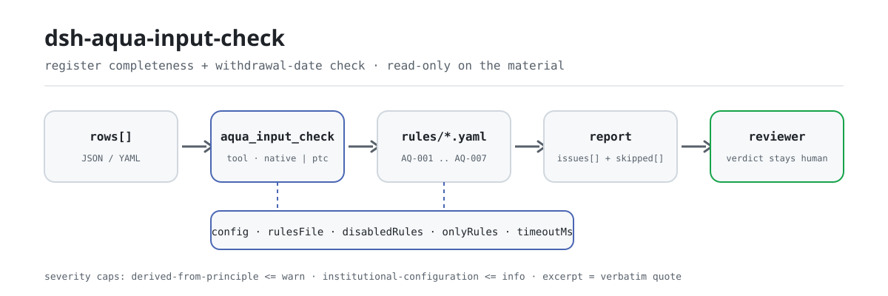

<div align="center">

<picture>
  <source media="(prefers-color-scheme: dark)" srcset="docs/assets/dsh-aqua-input-check-flow-dark.svg">
  
</picture>

# dsh-aqua-input-check

**Verifica a completude de um registo de insumos de aquicultura e a aritmética de datas do período de retirada — obtém uma lista de que linha, que coluna e o que falta; o veredito fica com o revisor.**

Um plugin verificador só de dados para o DeepSeek Harness: lê um registo de insumos (o cabeçalho da exploração mais uma linha por registo), aplica o pacote de regras versionado que traz consigo (AQ-001..AQ-007) e apenas lista as diferenças que consegue apontar dentro do material — nunca um veredito de conformidade, nunca uma atribuição de responsabilidade.

[Instalar](#instalação-em-três-passos) · [Configuração](#configuração) · [FAQ](#faq) · [简体中文](README.md) · [English](README.en.md) · [Español](README.es.md) · [Português](README.pt.md) · [हिन्दी](README.hi.md)

[](LICENSE)
[](#compatibilidade)
[](https://www.npmjs.com/package/dsh-aqua-input-check)
[](https://github.com/PerryLink/dsh-aqua-input-check/actions/workflows/ci.yml)
[](#compatibilidade)

[](https://github.com/PerryLink/dsh-aqua-input-check/stargazers)
[](https://www.npmjs.com/package/dsh-aqua-input-check)
[](https://dshfind.com/plugins/PerryLink/dsh-aqua-input-check?ref=badge)
[](https://securityscorecards.dev/viewer/?uri=github.com/PerryLink/dsh-aqua-input-check)
[](https://dsh.market/)
[](https://gitee.com/perrylink/dsh-aqua-input-check)

```sh
dsh plugin --profile <name> add dsh-aqua-input-check
```

</div>

<sub>Plugin da comunidade, sem afiliação com a DeepSeek. Repositório canónico: <https://github.com/PerryLink/dsh-aqua-input-check> (o Gitee é um espelho).</sub>

## O que é

`dsh-aqua-input-check` lê um registo de insumos de aquicultura —o cabeçalho da exploração mais uma linha por registo de insumo— e verifica a completude e a aritmética de datas desse registo: se cada registo indica o seu tanque e a sua espécie, se um insumo com nome registado indica a sua quantidade e a sua data de utilização, se a data de utilização não é futura, se a colheita respeita o período de retirada que o próprio registo declara, se o registo de povoamento anota a sua origem e o seu número de certificado de quarentena, se o tipo de insumo vem do vocabulário que você configurar e se os números de lote são únicos.

Não decide se a prática de cultivo está em conformidade, se o produto é seguro para consumo, se a medicação foi adequada ou se é devida uma sanção.

- **Para quem é**: responsáveis pelos registos de uma exploração aquícola; não é precisa linha de comandos, basta entregar o material na conversa.
- **O que você entrega**: o material de origem sobre o qual a verificação trabalha (uma tabela, um registo ou um documento); o original nunca é modificado. Excel pode ser convertido antes para JSON/YAML, na própria conversa se a plataforma o permitir.
- **O que recebe de volta**: uma lista de «que linha, que coluna, o que falta, como corrigir»; cada verificação que não pôde ser executada aparece em `skipped` com o seu motivo.

## Instalação em três passos

1. **Instale** (escolha um canal):

   ```sh
   # canal git (main mais recente; equivalente a git+https://github.com/PerryLink/dsh-aqua-input-check.git)
   dsh plugin --profile <name> add github:PerryLink/dsh-aqua-input-check
   # canal npm (versões publicadas)
   dsh plugin --profile <name> add dsh-aqua-input-check
   # canal tarball: pnpm pack neste repositório e depois
   dsh plugin --profile <name> add ./dsh-aqua-input-check-<version>.tgz
   ```

2. **Configuração mínima** (predefinições prontas; uma linha de bundle sem `config` aplica todas as predefinições e o caminho do pacote de regras aponta para o `rules/aqua-input-check.yaml` incluído):

   ```yaml
   - insert:
       - id: dsh-aqua-input-check
         name: dsh-aqua-input-check
   ```

3. **Verifique que monta**:

   ```sh
   dsh --profile <name> --dump-config | grep 'dsh-aqua-input-check'
   ```

   Depois entregue-lhe um registo —por exemplo a amostra incluída no repositório (saída esperada em `samples/quickstart/expected/result.json`):

   ```text
   > Executa esta verificação com a amostra incluída e diz-me quantos achados há e de que nível.
   aqua_input_check: 1 issue(s) — warn 1 (AQ-001: tanque e espécie vazios); skipped: 2
   ```

**Desinstalar**: `dsh plugin --profile <name> remove dsh-aqua-input-check` (ou remova a linha do patch do perfil).

<details>
<summary>Usar no WorkBuddy / Coze</summary>

Procure «Professional Document Check Suite» no WorkBuddy / Coze (o conjunto completo; esta verificação é uma parte; disponibilidade conforme a loja) para invocar a mesma capacidade de verificação sem linha de comandos.

</details>

<details>
<summary>Instalar a partir do mercado do DSH Desktop</summary>

Todos os plugins PerryLink podem ser explorados no mercado integrado do DSH Desktop: **Mercado → Fontes → Adicionar fonte → cole** `https://perrylink-dsh-catalog.perrylink.workers.dev/catalog-source.json` **→ selecione**. A instalação continua a exigir a verificação de identidade npm do mercado e a sua confirmação.

</details>

## Capacidades principais

`dsh-aqua-input-check` regista a ferramenta `aqua_input_check`: lê um registo de insumos, aplica um pacote de regras versionado e devolve um relatório.

- **Sete regras num pacote de dados** — o pacote de regras é dados, não código (`rules/aqua-input-check.yaml`); substituí-lo troca todo o conjunto de regras sem tocar numa linha de TypeScript.
- **Apenas leitura sobre o material** — aceita JSON ou YAML e nunca modifica o original; ESM puro, sem pedidos de rede e sem chamadas ao modelo.
- **Sem citações inventadas** — cada regra traz `document` / `number` / `clause` / `excerpt` / `kind` / `source`; `excerpt` tem de ser uma citação literal, e as regras cujo texto da cláusula não foi obtido desta vez dizem-no no próprio `excerpt` e permanecem marcadas como `derived-from-principle`.
- **A severidade segue a evidência** — `derived-from-principle` tem teto `warn`, a configuração institucional (`institutional-configuration`) tem teto `info`, e um teste garante-o.
- **Uma lista vazia nunca é «está tudo bem»** — cada verificação que não pôde ser executada é reportada em `skipped` com o seu motivo; uma regra cuja lista obrigatória não está configurada reporta-se em `skipped` em vez de passar em silêncio.
- **Sem redação adjudicadora** — o relatório lista diferenças e nunca se pronuncia sobre conformidade, responsabilidade ou correção; um guardião de redação (wording guard) impõe isto e cada relatório traz a declaração de exoneração.

| Regra | Verificação | Severidade | Tipo de base |
|---|---|---|---|
| `AQ-001` | o tanque e a espécie estão registados | warn | principle |
| `AQ-002` | um insumo com nome regista a sua quantidade e a sua data | warn | principle |
| `AQ-003` | a data de utilização não é futura | warn | principle |
| `AQ-004` | a colheita respeita o período de retirada registado | warn | principle |
| `AQ-005` | o povoamento regista a sua origem e o seu número de quarentena | warn | principle |
| `AQ-006` | o tipo de insumo vem do seu vocabulário (desativada por predefinição) | info | local |
| `AQ-007` | os números de lote são únicos | warn | principle |

### Exemplos

Estes são os pontos de entrada reais do plugin; instale uma vez e invoque um. A primeira linha da tabela abaixo é o percurso detalhado e as restantes são casos curtos.

**Exemplo detalhado** — ferramenta `aqua_input_check`, entrada:

```json
{"rows":[{"序号":"1","塘口编号":"","养殖品种":"","投苗日期":"2026-02-20", ...}]}
```

Saída:

```json
{
  "id": "dsh-aqua-input-check.AQ-001.de09b5a6",
  "ruleId": "AQ-001",
  "severity": "warn",
  "locator": {
    "row": 1,
    "field": "pondNo"
  },
  "found": "第 1 行 pondNo、species 都为空",
  "expected": "pondNo、species 至少应填写一项",
  "fix": "补填塘口编号与养殖品种；本条只核对是否填写"
}
```

*Observado em `dsh-aqua-input-check/tests/fixtures/AQ-001/AQ-001-unsafe.json; dsh-aqua-input-check/tests/fixtures/AQ-001/cases.json; dsh-aqua-input-check/rules/aqua-input-check.yaml; dsh-aqua-input-check/tests/index.test.ts`*

| Você pergunta | O que ele responde |
|---|---|
| Um registo indica o insumo, mas deixa vazias as colunas do tanque e da espécie. | `AQ-001` exige pelo menos um de `pondNo` e `species` em cada registo. Apenas verifica que um dos dois está preenchido e não julga se esse insumo é adequado a essa espécie. |
| O nome do insumo está preenchido, mas a quantidade e a data de utilização estão vazias. | `AQ-002` exige `inputQty` e `usedAt` sempre que `inputName` esteja preenchido. Verifica que os campos estão registados, não que a dose seja adequada nem que o medicamento corresponda à doença. |
| A data de utilização está escrita como `15/03/2026` e uma linha traz a data do mês seguinte. | `AQ-003` aceita `2026-03-15` e `2026-03-15 09:30`; um `usedAt` que não consegue analisar é reportado como não analisável, e um posterior à data de verificação é reportado como data futura. Não toca no período de retirada: o pacote não inclui qualquer número de dias de retirada. |
| Tratámos a 1 de junho com 20 dias de retirada registados e colhemos a 15 de junho. Isso é detetado? | Sim. `AQ-004` compara `usedAt`, `harvestAt` e o `withdrawalDays` que o próprio registo indica, e reporta a linha com os dias em falta. Um achado significa «segundo o período de retirada que você registou, a colheita chegou antes», não que o produto seja inseguro: isso exige um resultado de resíduos que este plugin não consegue ver. Se os três campos não estiverem todos preenchidos e analisáveis, a regra reporta `skipped` em vez de presumir um período. |
| O tipo de insumo que usamos não está na lista e nada é reportado. | `AQ-006` reporta `skipped` porque o pacote não traz qualquer vocabulário de tipos de insumo: `values` está vazio até você o configurar. Depois de configurado, a regra verifica que o `inputType` registado é um dos seus valores. Não julga se esse insumo pode ser legalmente utilizado: isso exige a lista de medicamentos proibidos e o número de aprovação do produto. |
| O mesmo número de lote aparece em duas linhas. | `AQ-007` reporta a repetição e indica as duas linhas. Compara ignorando os espaços em branco; vários registos de insumo para um mesmo lote são normais desde que partilhem o número de lote: não reutilize para isso a coluna do número de linha. Sem coluna de número de lote, reporta que não pôde ser executada em vez de passar em silêncio. |

## Normas que segue

| Documento | Número | Regras que o citam |
|---|---|---|
| 《水产养殖质量安全管理规定》 | 农业部令（现行令号与条号本次未核实） | AQ-001, AQ-002, AQ-005, AQ-007 |
| 《绿色食品 渔药使用准则》 | NY/T 755—2022（2022-07-11 发布、2022-10-01 实施；全部代替已废止的 NY/T 755—2013；属绿色食品系列标准；条号本次未取得） | AQ-003, AQ-004 |
| 本机构养殖生产管理口径（本机构配置） | 无统一标准（本条依据为本机构配置的类型口径） | AQ-006 |

**Limite:** este plugin verifica a completude e a aritmética de datas de um **registo de insumos de aquicultura**: se cada registo indica o seu tanque e a sua espécie, se um insumo com nome regista a sua quantidade e a sua data de utilização, se a data de utilização não é futura, se a colheita respeita o período de retirada que o registo declara, se o povoamento regista a sua origem e o seu certificado de quarentena, se o tipo de insumo vem do seu vocabulário e se os números de lote são únicos. **Não** decide se a prática de cultivo está em conformidade, se o produto é seguro para consumo, se a medicação foi adequada ou se é devida uma sanção.

> ### ⚠️ Leia isto antes de confiar numa citação do relatório
>
> **O estado de cada `excerpt` é por regra, não uniforme.** Algumas regras citam a cláusula literalmente (`kind: direct`), outras derivam do princípio dos artigos citados (`kind: derived-from-principle`, com teto `warn`) e outras usam limites configurados pela sua instituição (`kind: institutional-configuration`, com teto `info`). O pacote nunca parafraseia uma citação: quando o texto não foi obtido, o campo `excerpt` diz-o e o raciocínio vive em `note`; um teste garante que nenhuma regra afirma ter uma citação que não tem. **Para qualquer regra ainda marcada como não obtida, substitua o `excerpt` pela cláusula real e eleve `kind` a `direct` quando tiver o texto.**
>
> A conclusão é do revisor: este plugin lista as diferenças que consegue apontar no material e não decide factos nem conformidade.

## Configuração

Todos os parâmetros ajustáveis são campos `Config` de Schemastery em `src/config.ts` (alteráveis a partir do cordis.yml); os limites por regra vivem no pacote de regras sob `rules/`. Uma substituição por id substitui a linha inteira: repita todas as chaves de que precisa.

| Chave | Tipo | Padrão | Descrição |
|---|---|---|---|
| `rulesFile` | string | `rules/aqua-input-check.yaml` | Caminho do pacote de regras, relativo à raiz do pacote |
| `disabledRules` | string[] | `[]` | Ids de regras a desativar; cada uma aparece em `skipped` |
| `onlyRules` | string[] | `[]` | Executar apenas estas regras; vazio executa todas |
| `skipNotes` | string | `""` | Nota acrescentada a cada motivo de `skipped` |
| `timeoutMs` | number | `120000` | Orçamento de tempo limite cooperativo da ferramenta |

Parâmetros por regra que vale a pena conhecer:

- `AQ-004` `earlierField` / `laterField` / `minDaysField` — as duas datas e a coluna que guarda o intervalo exigido. O período vem do registo, por isso nenhum número vem incorporado.
- `AQ-006` `values` — os seus tipos de insumo, por exemplo `[ração composta, peixe fresco, melhorador da qualidade da água, antibacteriano, antiparasitário, desinfetante, vacina]`. Vazio significa sem verificação.
- `AQ-002` `conditionField` / `requiredFields` — o que desencadeia a exigência de quantidade e data.

Exemplo de substituição no patch do seu perfil:

```yaml
- insert:
    - id: dsh-aqua-input-check
      name: dsh-aqua-input-check
      config:
        disabledRules: [AQ-007]
        timeoutMs: 180000
```

## Formato do material

A ferramenta aceita JSON ou YAML:

```yaml
farm: 某某水产养殖场
site: 某某镇某某村
area: 86 亩
rows:
  - { 序号: '1', 批次编号: B-2026-0001, 塘口编号: T-03, 养殖品种: 草鱼,
      投苗日期: 2026-02-20, 苗种来源: 某某苗种场, 检疫证号: JY-2026-0031,
      投入品类型: 配合饲料, 投入品名称: 草鱼配合饲料 2 号, 投入量: '350',
      投入量单位: kg, 使用日期: 2026-03-01, 休药期天数: '0', 起捕日期: 2026-06-20 }
```

Os nomes das colunas são cotejados sem distinção de maiúsculas e ignorando espaços, sublinhados e hífenes; os nomes próprios do registo são mantidos, pelo que um achado nomeia a coluna que leu. Note que a coluna do número da linha é lida como o número visível da linha: dê ao identificador de lote a sua própria coluna. Os campos são opcionais na camada de leitura e validados pelo motor de verificação, pelo que uma exportação parcial produz achados de «item em falta» em vez de uma falha.

## Fontes das regras

Os dados das regras vivem em `rules/aqua-input-check.yaml`, separados do código: cada regra traz documento, número, cláusula na numeração própria da fonte, trecho literal e URL de origem. O cabeçalho do pacote declara por completo a lacuna de citações desta passagem, e o `note` de cada regra repete a parte que lhe diz respeito. O guardião de carga que normalmente impõe «um trecho deve ser uma citação real de pelo menos oito caracteres» não sabe distinguir uma citação de uma descrição, por isso este pacote apoia-se no cabeçalho, nas notas por regra e num teste que garante que todo `excerpt` admite a lacuna. Um pacote que exagere a sua base falha ao carregar em vez de produzir um relatório de aspeto confiante. Os limites confirmados durante a verificação e as conclusões deliberadamente **não** afirmadas vêm no diretório `rules/evidence/` incluído.

## FAQ

<details>
<summary>Ele decide a conformidade por nós?</summary>

Não. Apenas lista as diferenças que consegue apontar dentro do material (que linha, que coluna, o que falta, como corrigir) e não decide factos nem conformidade: a conclusão fica sempre com o revisor. Um guardião de redação impõe a redação do relatório e cada relatório traz a declaração de exoneração.

</details>

<details>
<summary>O meu registo é um Excel. Posso usá-lo diretamente?</summary>

Sim — converta-o primeiro para JSON ou YAML; na conversa a plataforma pode fazer a conversão por si, se o permitir. A ferramenta apenas lê o material e nunca modifica o original.

</details>

<details>
<summary>Porque é que `AQ-006` nunca reporta nada?</summary>

Porque o pacote não traz qualquer vocabulário de tipos de insumo: `values` vem vazio de fábrica, pelo que a regra se reporta em `skipped`. Preencha `values` com os tipos de insumo que a sua exploração usa e a regra começa a verificar que o tipo registado é um deles; continua sem julgar se um insumo pode ser legalmente utilizado.

</details>

<details>
<summary>Uma lista `issues` vazia pode ser lida como «nada está errado»?</summary>

Não. Cada verificação que não pôde ser executada aparece em `skipped` com o seu motivo (uma data em falta, um período de retirada em falta, um vocabulário por configurar). Leia `issues` e `skipped` em conjunto antes de tirar qualquer conclusão de um relatório.

</details>

<details>
<summary>Aguenta uma temporada inteira de registos de uma vez?</summary>

A ferramenta funciona nos modos `native` e `ptc`; para trabalho em lote (uma temporada de registos ou um diretório inteiro) use `ptc`, onde o custo do esquema é pago uma só vez. As verificações em si são cotejo de colunas e aritmética de datas locais: sem pedidos de rede e sem chamadas ao modelo; `timeoutMs` (120 s por predefinição) é o orçamento de tempo limite cooperativo.

</details>

## Resolução de problemas

- **`AQ-004` reporta-se como `skipped`.** Falta uma das duas datas ou o período de retirada. Registos de alimentação sem colheita, por exemplo, ficam simplesmente fora do seu âmbito.
- **`AQ-004` dispara mas acredito que o lote é seguro.** O achado é aritmética: a colheita chegou antes do período **que você registou**. Se os resíduos são um problema, decide-o um resultado de análise.
- **`AQ-006` nunca executa.** O seu vocabulário está vazio; preencha-o com os tipos de insumo que a sua exploração usa.
- **`AQ-007` dispara sobre um lote com vários registos de insumo.** Vários registos de um mesmo lote devem partilhar o número de lote. Se o seu registo numera cada linha, desative a regra ou use uma coluna identificadora distinta.
- **O plugin instala mas a ferramenta não aparece.** Confirme que `main` resolve para `lib/index.mjs` e que `pnpm run build` o gerou; um `main` errado faz o carregador saltar a entrada em silêncio.
- **`dsh plugin add` recusa o pacote como incompatível.** A faixa de peers cobre `0.1.x` e `0.2.x`; se o seu runtime ficar fora dela, conceda uma isenção explícita: `dsh plugin --profile <name> allow-version dsh-aqua-input-check@0.1.0 --dsh-version <runtime> --accept-risk`
- **`check` informa `manifest-peers` como falha.** O verificador estático compara contra uma faixa de peers fixada no código, anterior à linha 0.2. O runtime impõe a compatibilidade na instalação, pelo que a faixa declarada é a correta; é um problema conhecido a montante em `dsh-plugin-dev`.
- **As horas parecem deslocadas.** Toda a aritmética é de relógio local sobre as cadeias fornecidas, sem conversão de fuso horário.

## Compatibilidade

| Superfície | Estado |
|---|---|
| Harness | Faixa de peers `>=0.1.2-rc.1 <0.2.0 \|\| >=0.2.0-0 <0.3.0` — verificada para aceitar tanto `0.2.0-rc.2` quanto `0.2.1-rc.2`. `engines.dsh` é declarado como `>=0.2.1-0 <0.3.0` e o host o aplica desde 0.2.1 |
| Node | `^22.19.0 \|\| >=24.0.0` |
| Plataformas | Todas (ESM puro; sem código nativo, sem rede, sem chamada ao modelo) |
| Modo de ferramenta | Funciona em `native` e `ptc`; para um diretório inteiro use `ptc` |

## Ecossistema e qualidade

- [Espelho Gitee](https://gitee.com/perrylink/dsh-aqua-input-check) (espelho sincronizado; o GitHub é o canónico)
- [Página do plugin no dshfind](https://dshfind.com/plugins/PerryLink/dsh-aqua-input-check) (instalações e classificação)
- [Relatório OpenSSF Scorecard](https://securityscorecards.dev/viewer/?uri=github.com/PerryLink/dsh-aqua-input-check) (impulsionado por [.github/workflows/scorecard.yml](.github/workflows/scorecard.yml))
- [DSH Market](https://dsh.market/) (listado)
- **Canal da loja 1024**: `npm i -g dsh1024` uma vez, depois `dsh1024 plugin --profile <name> add dsh-aqua-input-check` (conta para a classificação de instalações do [deepseek1024.com](https://deepseek1024.com))
- [Base de conhecimento do ecossistema](https://perrylink.github.io/dsh-plugin-guide/) — guia de desenvolvimento de plugins · dados medidos de seleção · critérios de manutenção

## Desenvolvimento

```sh
pnpm install                                        # node ^22.19 || >=24
pnpm run typecheck                                  # tsc --noEmit
pnpm test                                           # vitest: suite partilhada de plugins de tabelas + fixtures emparelhados
pnpm run build                                      # tsdown -> lib/index.mjs + lib/index.d.mts
pnpm run verify:self-contained                      # as specs de dependências resolvem a partir do registry
pnpm run check:lockfile                             # deriva do lockfile
pnpm run check:readmes                              # coerência dos cinco README
pnpm run check:citations                            # linha de base de citações do pacote de regras
node ../scripts/sync-shared.mjs dsh-aqua-input-check   # refresca src/shared a partir de ../_shared
pnpm pack                                           # o tarball publicado
```

O plugin é **só de dados**: `src/model.ts` declara a forma da tabela, o kit partilhado fornece o leitor e o motor de verificação, e o pacote de regras declara cada verificação. Execução local da amostra (precisa de `pnpm run build` primeiro para produzir `lib/`):

```sh
node samples/quickstart/run.mjs --json
# => {"tool":"aqua_input_check","issueCount":1,"summary":{"error":0,"warn":1,"info":0},"skippedCount":2}
```

A entrada da amostra vive em `samples/quickstart/input/`, a saída esperada em `samples/quickstart/expected/result.json` e uma captura de ecrã em `docs/assets/quickstart.png`. As imagens do README são geradas programaticamente por [`scripts/gen-readme-assets.py`](scripts/gen-readme-assets.py) (Python + Pillow) e o script pode ser reexecutado; o diagrama de fluxo antigo de uma só pele e as imagens de demonstração ficam em `docs/assets/` para ligações externas, enquanto os README só referenciam o novo par claro/escuro.

Topics: `deepseek-harness`, `dsh`, `dsh-plugin`, `cordis`, `aqua`, `input`

## Família e agradecimentos

Este projeto faz parte da família de plugins DeepSeek Harness da [PerryLink](https://github.com/PerryLink) (todos Apache-2.0). Índice completo da família: [escolha um verificador por material](https://perrylink.github.io/zh/checkers/choose/) e [todos os plugins](https://github.com/PerryLink). Se lhe for útil, **uma estrela ajuda a próxima pessoa a encontrá-lo** — nada está bloqueado atrás dela.

- [@PerryLink](https://github.com/PerryLink) — criador e mantenedor: o pacote de regras só de dados (AQ-001..AQ-007), a ferramenta `aqua_input_check`, o registo de verificação de citações e a documentação em cinco línguas.

<details>
<summary>Expandir todos os plugins</summary>

| Plugin | Estado |
|---|---|
| **[dsh-aqua-input-check](https://github.com/PerryLink/dsh-aqua-input-check)** |  |
| **[dsh-archive-check](https://github.com/PerryLink/dsh-archive-check)** |  |
| **[dsh-auto-review](https://github.com/PerryLink/dsh-auto-review)** |  |
| **[dsh-autotier](https://github.com/PerryLink/dsh-autotier)** | 🧊 CONGELADO — ver o README do repo |
| **[dsh-bid-ca-precheck](https://github.com/PerryLink/dsh-bid-ca-precheck)** |  |
| **[dsh-bid-qual-check](https://github.com/PerryLink/dsh-bid-qual-check)** |  |
| **[dsh-cert-mcp](https://github.com/PerryLink/dsh-cert-mcp)** | 🧊 CONGELADO — ver o README do repo |
| **[dsh-checkpoint-rewind](https://github.com/PerryLink/dsh-checkpoint-rewind)** |  |
| **[dsh-click](https://github.com/PerryLink/dsh-click)** |  |
| **[dsh-composer-history](https://github.com/PerryLink/dsh-composer-history)** |  |
| **[dsh-contract-stance](https://github.com/PerryLink/dsh-contract-stance)** |  |
| **[dsh-customs-doc-check](https://github.com/PerryLink/dsh-customs-doc-check)** |  |
| **[dsh-data-quality](https://github.com/PerryLink/dsh-data-quality)** | 🧊 CONGELADO — ver o README do repo |
| **[dsh-demurrage-ledger](https://github.com/PerryLink/dsh-demurrage-ledger)** |  |
| **[dsh-doublecheck](https://github.com/PerryLink/dsh-doublecheck)** |  |
| **[dsh-drill-script-check](https://github.com/PerryLink/dsh-drill-script-check)** |  |
| **[dsh-eia-guide-check](https://github.com/PerryLink/dsh-eia-guide-check)** |  |
| **[dsh-emergency-plan](https://github.com/PerryLink/dsh-emergency-plan)** |  |
| **[dsh-essay-rubric-check](https://github.com/PerryLink/dsh-essay-rubric-check)** |  |
| **[dsh-evidence-check](https://github.com/PerryLink/dsh-evidence-check)** |  |
| **[dsh-export-ctl-check](https://github.com/PerryLink/dsh-export-ctl-check)** |  |
| **[dsh-fast](https://github.com/PerryLink/dsh-fast)** |  |
| **[dsh-fmea-table-check](https://github.com/PerryLink/dsh-fmea-table-check)** |  |
| **[dsh-forecast-penalty](https://github.com/PerryLink/dsh-forecast-penalty)** |  |
| **[dsh-fund-research](https://github.com/PerryLink/dsh-fund-research)** |  |
| **[dsh-github](https://github.com/PerryLink/dsh-github)** |  |
| **[dsh-gongwen-flow-check](https://github.com/PerryLink/dsh-gongwen-flow-check)** |  |
| **[dsh-gongwen-word-check](https://github.com/PerryLink/dsh-gongwen-word-check)** |  |
| **[dsh-guard-plan-qc](https://github.com/PerryLink/dsh-guard-plan-qc)** |  |
| **[dsh-hazchem-check](https://github.com/PerryLink/dsh-hazchem-check)** |  |
| **[dsh-hazplan-check](https://github.com/PerryLink/dsh-hazplan-check)** |  |
| **[dsh-hidden-risk-map](https://github.com/PerryLink/dsh-hidden-risk-map)** |  |
| **[dsh-hs-classify](https://github.com/PerryLink/dsh-hs-classify)** |  |
| **[dsh-icd-rule-check](https://github.com/PerryLink/dsh-icd-rule-check)** |  |
| **[dsh-industry-research](https://github.com/PerryLink/dsh-industry-research)** |  |
| **[dsh-lawcite-adapter](https://github.com/PerryLink/dsh-lawcite-adapter)** |  |
| **[dsh-laya](https://github.com/PerryLink/dsh-laya)** |  |
| **[dsh-lc-doc-check](https://github.com/PerryLink/dsh-lc-doc-check)** |  |
| **[dsh-learning-gap-check](https://github.com/PerryLink/dsh-learning-gap-check)** |  |
| **[dsh-library](https://github.com/PerryLink/dsh-library)** |  |
| **[dsh-local-ai](https://github.com/PerryLink/dsh-local-ai)** |  |
| **[dsh-lsp-actions](https://github.com/PerryLink/dsh-lsp-actions)** |  |
| **[dsh-mask](https://github.com/PerryLink/dsh-mask)** |  |
| **[dsh-mcp-panel](https://github.com/PerryLink/dsh-mcp-panel)** |  |
| **[dsh-medrec-qc](https://github.com/PerryLink/dsh-medrec-qc)** |  |
| **[dsh-memento](https://github.com/PerryLink/dsh-memento)** | 🧊 CONGELADO — ver o README do repo |
| **[dsh-nsfc-form-check](https://github.com/PerryLink/dsh-nsfc-form-check)** |  |
| **[dsh-nurse-record-check](https://github.com/PerryLink/dsh-nurse-record-check)** |  |
| **[dsh-observe](https://github.com/PerryLink/dsh-observe)** |  |
| **[dsh-origin-rvc-check](https://github.com/PerryLink/dsh-origin-rvc-check)** |  |
| **[dsh-ota-review-check](https://github.com/PerryLink/dsh-ota-review-check)** |  |
| **[dsh-output-styles](https://github.com/PerryLink/dsh-output-styles)** |  |
| **[dsh-paper-doc-adapter](https://github.com/PerryLink/dsh-paper-doc-adapter)** |  |
| **[dsh-permission-rules](https://github.com/PerryLink/dsh-permission-rules)** |  |
| **[dsh-permit-report-check](https://github.com/PerryLink/dsh-permit-report-check)** |  |
| **[dsh-pipeline-check](https://github.com/PerryLink/dsh-pipeline-check)** |  |
| **[dsh-pleading-draft](https://github.com/PerryLink/dsh-pleading-draft)** |  |
| **[dsh-plugin-doctor](https://github.com/PerryLink/dsh-plugin-doctor)** | 🚫 APOSENTADO (repo arquivado) |
| **[dsh-plugin-guide](https://github.com/PerryLink/dsh-plugin-guide)** |  |
| **[dsh-plugin-kit](https://github.com/PerryLink/dsh-plugin-kit)** | 🚫 APOSENTADO (repo arquivado) |
| **[dsh-plugin-upgrade](https://github.com/PerryLink/dsh-plugin-upgrade)** | 🚫 APOSENTADO (repo arquivado) |
| **[dsh-policy-brief-draft](https://github.com/PerryLink/dsh-policy-brief-draft)** |  |
| **[dsh-power-loss-split](https://github.com/PerryLink/dsh-power-loss-split)** |  |
| **[dsh-power-ticket-check](https://github.com/PerryLink/dsh-power-ticket-check)** |  |
| **[dsh-ppap-check](https://github.com/PerryLink/dsh-ppap-check)** |  |
| **[dsh-protest-deadline](https://github.com/PerryLink/dsh-protest-deadline)** |  |
| **[dsh-railway-window](https://github.com/PerryLink/dsh-railway-window)** |  |
| **[dsh-repair-order-qc](https://github.com/PerryLink/dsh-repair-order-qc)** |  |
| **[dsh-research-report](https://github.com/PerryLink/dsh-research-report)** |  |
| **[dsh-review-reply-check](https://github.com/PerryLink/dsh-review-reply-check)** |  |
| **[dsh-rulefile-check](https://github.com/PerryLink/dsh-rulefile-check)** |  |
| **[dsh-safety-brief-check](https://github.com/PerryLink/dsh-safety-brief-check)** |  |
| **[dsh-score](https://github.com/PerryLink/dsh-score)** | 🧊 CONGELADO — ver o README do repo |
| **[dsh-session-sync](https://github.com/PerryLink/dsh-session-sync)** |  |
| **[dsh-site-log-check](https://github.com/PerryLink/dsh-site-log-check)** |  |
| **[dsh-skill-pack-security](https://github.com/PerryLink/dsh-skill-pack-security)** |  |
| **[dsh-soe-decision-check](https://github.com/PerryLink/dsh-soe-decision-check)** |  |
| **[dsh-soilwater-check](https://github.com/PerryLink/dsh-soilwater-check)** |  |
| **[dsh-sop-sync-check](https://github.com/PerryLink/dsh-sop-sync-check)** |  |
| **[dsh-spc-gbt-adapter](https://github.com/PerryLink/dsh-spc-gbt-adapter)** |  |
| **[dsh-talk](https://github.com/PerryLink/dsh-talk)** |  |
| **[dsh-tender-extract](https://github.com/PerryLink/dsh-tender-extract)** |  |
| **[dsh-tender-matrix](https://github.com/PerryLink/dsh-tender-matrix)** |  |
| **[dsh-test-drive](https://github.com/PerryLink/dsh-test-drive)** |  |
| **[dsh-ticktick](https://github.com/PerryLink/dsh-ticktick)** | 🚫 APOSENTADO (repo arquivado) |
| **[dsh-translate](https://github.com/PerryLink/dsh-translate)** |  |
| **[dsh-warranty-calc](https://github.com/PerryLink/dsh-warranty-calc)** |  |
| **[dsh-budget](https://github.com/PerryLink/dsh-budget)** | 🧊 CONGELADO — ver o README do repo |
| **[dsh-claude-move](https://github.com/PerryLink/dsh-claude-move)** | 🧊 CONGELADO — ver o README do repo |
| **[dsh-defend](https://github.com/PerryLink/dsh-defend)** | 🧊 CONGELADO — ver o README do repo |
| **[dsh-draw](https://github.com/PerryLink/dsh-draw)** | 🧊 CONGELADO — ver o README do repo |
| **[dsh-reach](https://github.com/PerryLink/dsh-reach)** | 🧊 CONGELADO — ver o README do repo |
| **[dsh-background-agents](https://github.com/PerryLink/dsh-background-agents)** | 🚫 APOSENTADO (repo arquivado) |
| **[dsh-session-pin](https://github.com/PerryLink/dsh-session-pin)** | 🚫 APOSENTADO (repo arquivado) |
| **[dsh-team-rooms](https://github.com/PerryLink/dsh-team-rooms)** | 🚫 APOSENTADO (repo arquivado) |

</details>

## Licença

[LICENSE](LICENSE) (Apache License 2.0) © 2026 dsh-aqua-input-check contributors

<p align="center"><sub>Apache-2.0 · Plugin da comunidade, sem afiliação com a DeepSeek.</sub></p>
